# PUNCAK KEBIADABAN BANGSA Perkosaan Etnik Tionghoa 13-14 Mei 1998 {.unlisted .hidden-heading}

Tim Pemburu Fakta mengolah isi buku mungil ini dari berbagai sumber. Terima kasih kepada:

Tim Relawan untuk Kemanusiaan, Divisi Kekerasan terhadap Perempuan

Badan Komunikasi Penghayatan Kesatuan Bangsa (Bakom PKB)

*Tempo Interaktif* *Majalah Matra*

*Majalah D & R*

Harian *Suara Pembaruan* *Radio Netherland*

Berita-Bhinneka Mailing List Solidaritas Nusa-Bangsa

Huaren NGO

dan semua pihak yang telah membantu dengan tulus, hingga buku ini dapat diterbitkan.

Salam hangat, Tim Pemburu Fakta

FOTO-FOTO Repro *Kompas*, *Jakarta Post*, *Panji Masyarakat*, *Media Indonesia*, *D&R*

Diterbitkan oleh Yayasan Karyawan Matra

---

# Menjebol Dinding Kebisuan

TIGA BULAN BERLALU SEJAK KERUSUHAN besar-besaran melanda Ibu Kota pada 13-14 Mei silam. Di tengah penjarahan pembakaran gedung dan kendaraan bermotor, masih ada segerombol “orang”—kalau masih bisa disebut demikian—yang tega-teganya menista tubuh sejumlah perempuan.

Biadab. Adakah kata lain yang lebih rendah artinya, dan pantas untuk menggambarkan napsu liar mereka? Bahkan hewan pun masih lebih “manusiawi” dalam melampiaskan birahinya.

Tragisnya lagi, setelah martabat dilecehkan, kini para perempuan yang jadi korban dan keluarga mereka bahkan tim relawan yang menolong dibungkam. Teror melanda. Kabar tentang beredarnya foto-foto dan video perkosaan, membuat nyali korban bertambah kecut.

Padahal, perempuan diciptakan Sang Pencipta dengan tujuan mulia. Dari dialah lahir generasi demi generasi. Dia adalah guru pertama bagi anak-anaknya. Perempuan senantiasa menjadi jiwa setiap komunitas di seluruh dunia.

Dilandasi rasa hormat dan penghargaan kepada kaum perempuan, buku ini kami terbitkan Bukan untuk menoreh goresan lagi pada luka yang masih berdarah, namun lebih pada upaya pencarian keadilan.

Mewakili mereka yang tertindas tanpa mampu membuka suara, kami intisarikan kejadian tragis memilukan, yang berlangsung di Jakarta—dengan jumlah korban terbanyak—dan di beberapa kota besar lain di Indonesia. Selamat membaca, dan memetik hikmahnya!

Perempuan diciptakan dari rusuk Adam bukan dari kepalanya untuk menjadi atasannya bukan pula dari kakinya untuk dijadikan alasnya melainkan dari sisinya untuk menjadi setara dengannya dekat pada lengannya untuk dilindunginya dan dekat dengan hatinya untuk dicintainya—Dale S. Hardley

---

# Jauh Hari Sebelumnya, Tanda Itu Sudah Tampak

INILAH TRAGEDI PALING PAHIT YANG PERNAH terjadi di bumi pertiwi. Tak ada dalih lagi untuk mengatakannya sebagai suatu gerakan massa yang muncul secara spontan.

Banyak bukti mengarah pada satu kesimpulan: kerusuhan dan pemerkosaan di Jakarta dan beberapa kota besar lain di Indonesia, yang berlangsung Mei lalu, merupakan KEJAHATAN TERORGANISIR dan SISTEMATIS, dengan etnik Tionghoa sebagai target sasarannya.

Sepanjang sejarah perjalanan bangsa Indonesia, tak dapat dipungkiri, telah terjadi beberapa kali kerusuhan anti Cina. Misalnya, saat tentara Jepang menyerbu Pulau Jawa, di wilayah Pantai Utara terjadi kerusuhan.

Setelah Proklamasi Kemerdekaan, terjadi pula beberapa kerusuhan anti Cina. Di antaranya, tahun 1963 di Bandung dan Cirebon, lalu tahun 1980-an di Solo. Tapi, itu “hanya” kerusuhan berupa pengrusakan bangunan dan kendaraan, tanpa merembet ke pemerkosaan.

Ketika tentara Jepang menyerbu Nanking, Cina, tahun 1937, terjadi penyiksaan dan pemerkosaan massal terhadap 80.000 perempuan di sana. Tatkala Jepang menduduki Korea, Taiwan, Indonesia, dan lainnya, muncul bentuk lain pemerkosaan, yakni *jugun ianfu*—wanita penghibur yang mengikuti para tentara Jepang

Namun, tetap saja ada perbedaan antara pemerkosaan massal di masa perang itu dengan pemerkosaan massal di alam kemerdekaan. Yang disebut pertama, dilakukan dalam masa tidak damai, dan oleh bangsa asing yang berstatus penjajah.

Sementara yang kedua, berlangsung saat tidak ada perang, dan dilakukan oleh bangsa sendiri. Tengok juga perkosaan bermotif politik di daerah-daerah rawan konflik seperti Irian Jaya, Timor Timur, dan Aceh, yang sekarang mulai disingkap.

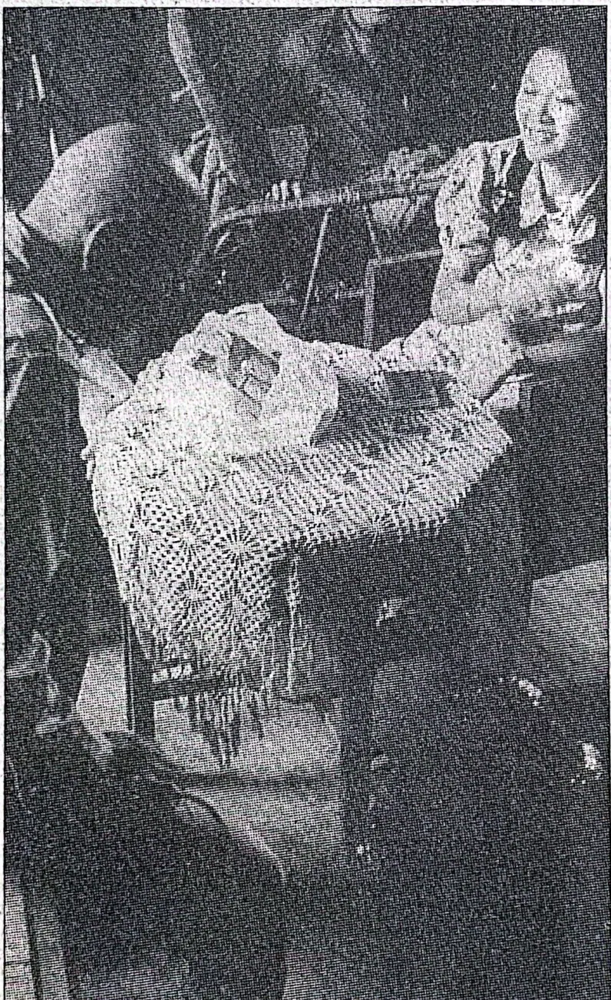

Karena itu, tak berlebihan jika Christianto Wibisono dalam salah satu tulisannya di sebuah harian Ibu Kota, menyebut rentetan peristiwa politik berdarah yang terjadi pada rezim Soeharto sebagai *The Rape of Indonesian Dignity*.

Memang, martabat bangsa ini tiba-tiba direnggut secara paksa dan kasar, oleh sekelompok orang yang tak bertanggung jawab, yang notabene masih saudara sebangsa setanah air. Teganya.

Simak saja pengakuan seorang hadirin tak dikenal, dalam sebuah pertemuan tim relawan yang menangani para korban kekerasan terhadap perempuan. “Saya ini bukan intel, tapi saya salah seorang komandan yang menggerakkan kerusuhan. Saya merekrut 60 orang dari berbagai angkatan. Saya bisa memperkosa perempuan-perempuan ini (seraya menunjuk pada tiga gadis Tionghoa). Membunuh Anda itu perkara mudah….”

Sebenarnya, rencana pemerkosaan yang terorganisir dan sistematis sudah dapat dicium jauh hari sebelumnya. Hanya, mungkin sang korban yang menerima peringatan dan ancaman, tidak menganggapnya terlalu serius.

“Suatu kali saya naik taksi. Ketika saya hendak membayar, sopir taksinya menolak. Katanya, enggak usah bayar. Kamu Cina, sebentar lagi akan habis dibantai dan diperkosa,” tutur salah seorang korban.

Pengalaman senada dialami pula seorang gadis Tionghoa di kawasan Jakarta Barat pada Maret silam. Ia pulang ke rumah naik bajaj. Setiba di tujuan, sopir bajaj tak mau dibayar. “Enggak usah. Oh, rumah lu di sini, ya. Hati-hati aja tanggal 27 nanti,” sang sopir memperingati.

Tak hanya sopir-sopir angkutan umum yang tahu rencana busuk itu. Angin kebencian juga sudah ditiupkan pada para pedagang kecil.

“Jauh sebelum kerusuhan, suatu hari saya dan seorang teman membeli teh botol. Tahu-tahu, saya disuruh membayar Rp 5.000. Mulanya saya keberatan. Saya merasa diperas. Tapi, beberapa lelaki yang tadinya hanya duduk di sekitar pedagang, berdiri dan mengancam. Katanya, mau apa kamu? Sebentar lagi juga habis dibantai. Karena takut, saya terpaksa membayar,” korban lain berkisah.

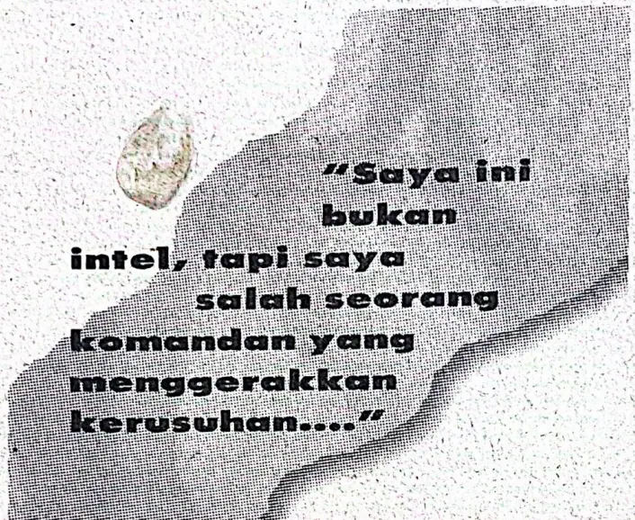

Masih merasa belum cukup, para perencana kerusuhan bergerak ke pemukiman-pemukiman miskin, yang letaknya berdekatan dengan pemukiman mewah.

Seorang laki-laki berbadan kekar, misalnya, mendatangi lokasi pemukiman miskin yang tak jauh dari Pantai Indah Kapuk. Mulanya, ia hanya berkenalan dengan para pemuda setempat.

Mereka mengobrol. Lalu, dengan ramah si kekar mentraktir para pemuda. Terjalinlah hubungan akrab antara kedua pihak. “Lelaki itu kemudian bilang, kalau lu mau, sebentar lagi lu dapat barang-barang mewah; dan bisa menggauli amoy-amoy yang selama ini enggak bisa dijamah,” beberapa saksi mata memberi kesaksian.

Akhirnya, tragedi berdarah itu betul terjadi. Bukan pada akhir Maret, seperti disinyalir sopir bajaj di atas. Barangkali, jaringan perencana merasa, saat itu momennya belum tepat. Tapi, pada 13-14 Mei 1998, kira-kira satu minggu sebelum rezim Orde Baru berakhir

Dan kebiadaban dalam kehidupan berbangsa pun mencapai puncaknya.

---

# Ke Mana Hilangnya Mayat-Mayat Perempuan Itu?

<strong>Kronologi dan Modus Operandi Pemerkosaan</strong>

“BUNUH CINA! GANYANG CINA!” TERIAK perusuh di tengah kobaran api. Yel-yel seperti itu terdengar di sentra bisnis dan permukiman warga keturunan Tionghoa, pada 13-14 Mei lalu.

Gelombang amuk massa itu awalnya belum berbau rasial. Dimulai pada pagi hari (13 Mei), saat massa menyaksikan aksi berkabung mahasiswa di Universitas Trisakti.

Mahasiswa berpidato dan meneriakkan yel-yel reformasi. Di luar, massa punya cara sendiri. Mereka mencegat kendaraan yang lewat, memaksa sopir turun, lantas membakar mobil.

Dari laporan Tim Relawan untuk Kemanusiaan setelah kerusuhan, terungkap fakta, di antara massa itu menyelinaplah sejumlah provokator. Merekalah yang pertama-tama berusaha memancing perhatian massa dengan cara membakar ban mobil, tumpukan kayu, atau bahkan kendaraan.

Menjelang tengah hari, kerusuhan meluas ke arah jalan Daan Mogot dan Kyai Tapa. Sementara di Jalan Hasyim Ashari, sejumlah toko dekat pintu kereta api dibakar.

Cat, perabot elektronika seperti TV, AC, kulkas, mesin cuci, dan sebagainya, diseret ke tengah jalan. Aksi terus berlangsung sepanjang sisa hari, hingga Ibu Kota dilanda ketegangan luar biasa.

## Mayat-Mayat Bergelimpangan

KEESOKAN HARINYA, JALAN HAYAM WURUK dan Jalan Gajah Mada yang sejak pukul 09.00 pagi diblokir, belakangan ikut luluh-lantak. Sepanjang hari, penjarahan, perusakan, dan pembakaran berlangsung.

“Sekitar pukul 11.30, saya melihat beberapa orang di antara massa mencegat mobil dan memaksa penumpang turun. Kemudian mereka menarik 2 orang gadis keluar dari mobil. Mereka mulai melucuti pakaian kedua perempuan itu, dan memperkosanya beramairamai. Kedua perempuan itu mencoba melawan, namun sia-sia,” ujar seorang saksi mata di kawasan Muara Angke, 14 Mei 1998.

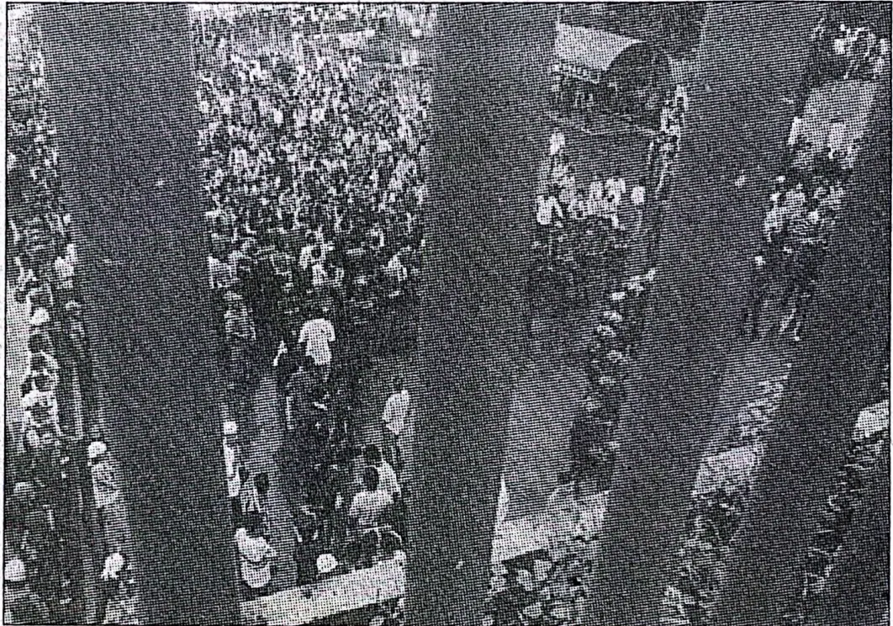

Memang, tidak semua perempuan yang menjadi korban, diperkosa. Ada yang cuma ditelanjangi, lalu dianiaya. Namun, banyak pula yang diperkosa, dianiaya, bahkan dibunuh atau terbunuh.

Tak banyak orang awam yang percaya, jika dalam amuk massa bermuatan rasial itu ternyata juga sarat dibebani kasus-kasus pelecehan dan pemerkosaan terhadap perempuan etnik Tionghoa.

Pasalnya, kerusuhan anti Cina itu sudah ’biasa” terjadi beberapa tahun sekali di negeri ini. Tapi, kalau kerusuhan dengan pemerkosaan massal? “Ah, masak sih? Jangan-jangan itu cuma isu,” begitu komentar yang terdengar, beberapa hari setelah kerusuhan. Namun, temuan demi temuan di lapangan, meruntuhkan dugaan banyak orang.

“Setelah kedua gadis itu berhasil melepaskan diri dari orang-orang biadab, saya mendekati mereka dan mendekapnya. Mereka minta saya membantu mencarikan jalan aman untuk pulang. Karena saya tinggal di daerah itu, saya hafal jalan pintas menuju jalan raya. Sesampai di perempatan Cengkareng, saya melihat beberapa mayat perempuan dalam keadaan telanjang, dengan muka ditutup koran. Perempuan-perempuan itu tampak telah diperkosa, karena dari alat vital mereka terlihat leleran darah mengering dan dikerubungi lalat,” masih cerita saksi mata di atas.

Usai menolong ke dua wanita itu, saksi mata tersebut pulang melewati jalan yang sama. Anehnya, ketika sampai di perempatan Cengkareng, mayat-mayat perempuan yang tadi bergelimpangan, sudah tidak ada lagi. Ke mana mayat-mayat itu? Siapa yang membawa mereka?

## Berapa Banyak Korban?

BEGITULAH SALAH SATU KISAH TRAGIS DARI ratusan pemerkosaan yang dilakukan di seputar peristiwa kerusuhan pertengahan Mei silam.

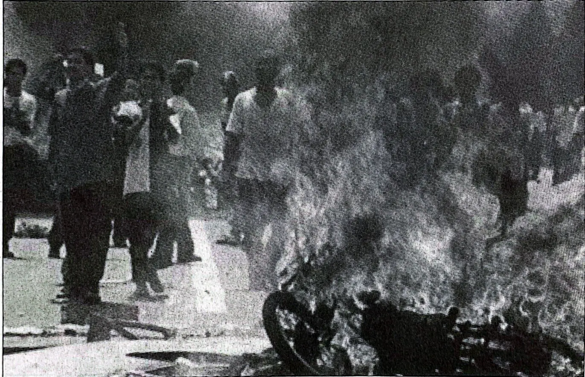

Hingga tanggal 3 Juli 1998, Tim Relawan untuk Kemanusiaan Divisi Kekerasan terhadap Perempuan telah menerima laporan 168 korban pemerkosaan dan pelecehan seksual massal. Jumlah korban terbanyak ada di Jakarta dan sekitarnya (152 korban), sisanya berasal dari Solo, Medan, Palembang, dan Surabaya.

Dari seluruh jumlah tersebut, 20 korban di antaranya telah meninggal dunia. Sedang kebanyakan yang masih hidup berada dalam kondisi fisik dan psikologis yang sangat berat.

Jumlah tersebut bisa saja masih bertambah terus. Sebab, diyakini masih ada korban-korban yang lebih memilih tutup mulut, daripada menanggung malu lebih besar. Ada pula korban yang segera diungsikan keluarganya ke luar negeri.

Pemantauan Badan Komunikasi Penghayatan Kesatuan Bangsa (Bakom PKB) lebih mengejutkan. Menurut Rosita Noer, ketua umum Bakom PKB Pusat, tercatat 468 perempuan yang mengalami kekerasan. Dari jumlah itu, ada 60 orang yang diperkosa lantas dibakar.

## Siapa Pelakunya?

UMUMNYA, PEMERKOSAAN DILAKUKAN oleh orang yang dikenali korban. Tapi, teori ini tak berlaku, saat mengulas pemerkosaan massal yang terjadi di Jakarta beberapa bulan lalu.

Sebab, pemerkosanya lebih dari satu orang. Mereka juga tidak dikenal korban dan penduduk setempat. Dari penelusuran awal Tim Relawan, diperoleh pola dalam pemilihan lokasi dan perlakuan yang sama terhadap korban.

Yang jadi incaran adalah rumah toko (ruko) di sepanjang jalan raya, yang menghubungkan dua kawasan. “Gerombolan pelaku ini datang menyerang, merusak ruko, memerkosa, dan kemudian membakar,” tandas Ita F. Nadia, koordinator Tim Relawan untuk Kemanusiaan Divisi Kekerasan terhadap Perempuan

### TABEL 1 Perbandingan Lokasi Perusakan-Pembakaran dan Lokasi Pemerkosaan-Pelecehan Seksual Massal {title="TABEL 1. Perbandingan Lokasi Perusakan-Pembakaran dan Lokasi Pemerkosaan-Pelecehan Seksual Massal"}

<table><tr><td>No.</td><td>Wilayah</td><td>Contoh Lokasi Kerusuhan</td><td>Contoh Lokasi Pemerkosaan</td></tr><tr><td>1</td><td>Jakarta Pusat</td><td>Wahid Hasyim (Tanah Abang), Jiung (Kemayoran), Samanhudi (Pasar Baru), Galur, Cempaka Putih, Sumur Batu, Salemba, Tanah Abang, Harmoni</td><td></td></tr><tr><td>2</td><td>Jakarta Selatan</td><td>Cinere, Pasar Minggu, Cipete, Fatmawati, Kalibata, Mampang, Bintaro</td><td></td></tr><tr><td>3</td><td>Jakarta Timur</td><td>Pasar Rebo, Kramat Jati, Kampung Melayu, Klender, Jatinegara, Matraman, Rawamangun, Kalimalang, Penas</td><td></td></tr><tr><td>4</td><td>Jakarta Barat</td><td>Palmerah, Kebayoran Lama, Grogol, Roxy, Green Garden, Bojong Indah, Jelambar, Jembatan Dua, Jembatan Lima, Gajahmada, Glodok, Cengkareng Cengkareng, Glodok</td><td>Angke, Jelambar, Jembatan Dua, Jembatan Tiga, Jembatan Lima, Jembatan Besi, Cengkareng Cengkareng, Glodok Kota</td></tr><tr><td>5</td><td>Jakarta Utara</td><td>Kelapa Gading, Mangga Dua, Pantai Indah Kapuk</td><td>Pluit, Pantai Indah Kapuk, Sunter</td></tr><tr><td>6</td><td>Sekitar Jakarta</td><td>Depok, Bekasi, Lenteng Agung, Tangerang, Ciputat, Cileduk</td><td>Tangerang, Bekasi</td></tr></table>

Sumber: Dokumentasi Tim Relawan untuk Kemanusiaan, kesaksian para korban, keluarga korban, dan saksi mata.

Fakta-fakta di lokasi kejadian memperkuat kesimpulan, kerusuhan dan pemerkosaan yang terjadi di Jakarta dan sekitarnya pada 13-14 Mei, dilakukan oleh sekelompok orang secara terorganisir dan sistematis.

Kalau peristiwa kerusuhan, perusakan, dan pembakaran massal saat itu terjadi di semua wilayah Jakarta; pemerkosaan massal hanya terjadi di kawasan Jakarta Barat, Jakarta Utara, dan beberapa wilayah lain yang selama ini dikenal sebagai konsentrasi tempat tinggal dan bekerja dari warga Tionghoa. Lebih jelas dapat dilihat pada tabel 1.

Dari pola lokasi pemerkosaan massal tersebut dapat diambil dua kesimpulan. Pertama, pelecehan seksual dan pemerkosaan massal itu terjadi di tempat yang sama dengan beberapa kawasan kerusuhan.

Kedua, pola lokasi pemerkosaan massal di atas menunjukkan dengan jelas, tindakan pemerkosaan massal dan perundungan seksual itu diarahkan kepada perempuan etnik Tionghoa. Gejala ini bisa dibuktikan dari identitas para korban yang terkumpul di Tim Relawan.

## Modus Operandi Pemerkosaan Massal

POLA-POLA YANG SANGATMIRIP DALAM MODUS operandi pemerkosaan massal, mulai menunjukkan bukti semakin kuat, bahwa peristiwa biadab itu melibatkan jaringan perencana dan pelaku.

Dari sejumlah kesaksian korban dan saksi mata, Tim Relawan menemukan adanya peran “komandan” kerusuhan yang naik sepeda motor atau mobil. Sang “komandan” inilah yang memberikan aba-aba dan menggerakkan massa.

Pola awal tindakan tampak sama di setiap tempat kejadian kerusuhan. Misalnya:

1.

Pengondisian massa untuk berkumpul di lokasi. Ini dilakukan dengan dua cara. Pertama, penyebaran isu lewat berbagai media (telepon, sopir kendaraan umum, orang per orang). Kedua, ada sekelompok orang yang membakar benda-benda disertai ajakan.

2.

Munculnya sekelompok orang yang berperan sebagai pengajak, sekaligus pengerah massa. Massa pada umumnya adalah warga daerah sekitar kejadian. Sedangkan kelompok pengajak, bukan berasal dari daerah setempat.

3.

Awal tindakan perusakan, penjarahan, dan pembakaran, sampai pemerkosaan, bisa dibedakan menjadi dua. Pertama, motor penggeraknya berbaur dengan massa dan meneriakkan yel-yel anti Cina. Kedua, si pengajak langsung ke barisan paling depan, memimpin, dan mengerahkan massa untuk menyerang.

4.

Selama dan setelah kerusuhan, berlangsung aksi teror disertai pemerasan, terutama ditujukan kepada pemilik rumah toko (ruko) atau perusahaan dan warga di perumahan. Para calon korban atau korban dipaksa membayar sejumlah uang sebagai jaminan keselamatan. Jumlahnya berkisar Rp 2 juta hingga Rp 80 juta.

Melihat pola umum tentang “awal tindakan” perusakan, penjarahan, hingga pemerkosaan, disinyalir paling tidak ada empat ciri orang/kelompok pengajak dan pemimpin, sebagaimana dikenali para korban dan saksi mata:

1.

Kelompok pemuda yang menggunakan pakaian pelajar SLTA atau pakaian mahasiswa.

2.

Kelompok remaja berpakaian lusuh dan berwajah dingin/sangar.

3.

Kelompok pemuda berbadan kekar, berambut cepak, dan bersepatu bot

4. Kelompok pemuda berbadan kekar, berwajah dingin/sangar, dan bertato.

### TABEL 2 Perbandingan Modus Operandi Kerusuhan dan Pemerkosaan Massal {title="TABEL 2. Perbandingan Modus Operandi Kerusuhan dan Pemerkosaan Massal"}

<table><tr><td>No.</td><td>Kerusuhan</td><td>Pemerkosaan</td></tr><tr><td>1</td><td>Usaha pengkondisian massa untuk berkumpul di lokasi yang akan menjadi sasaran perusakan, penjarahan, dan pembakaran, melalui penyebaran isu-isu tentang adanya aksi perusakan, penjarahan, dan pembakaran di lokasi yang akan menjadi sasaran.</td><td>Usaha 'indoktrinasi' dan pengkondisian massa untuk menjadikan perempuan-perempuan Tionghoa sebagai target perusakan dan pembantaian, melalui penyebaran isu tentang adanya aksi kerusuhan, pembantaian dan pemerkosaan terhadap warga Tionghoa.</td></tr><tr><td>2</td><td>Isu disebarkan melalui telepon, sopir-sopir angkutan umum, dan orang per orang.</td><td>Isu disebarkan lewat telepon, sopir-sopir (taksi, bajaj, angkot), pedagang-pedagang kecil, dan orang per orang.</td></tr><tr><td>3</td><td>Ada orang atau sekelompok orang yang berperan sebagai pengajak dan/atau sekaligus pemimpin- pengarah massa, agar melakukan perusakan, penjarahan, dan pembakaran.</td><td>Ada orang atau sekelompok orang yang memberi komando, atau mengarahkan langkah dan tindak pemerkosaan.</td></tr><tr><td>4</td><td>Pelaku tidak dikenali oleh warga setempat, dan didatangkan dari tempat yang tidak diketahui warga.</td><td>Pelaku tidak dikenali oleh warga setempat, dan didatangkan dari tempat yang tidak diketahui.</td></tr><tr><td>5</td><td>Pemimpin atau pengajak-pengarah massa meneriakkan yel-yel anti Cina.</td><td>Komandan dan/atau pemimpin- pengarah massa meneriakkan yel-yel anti Cina.</td></tr><tr><td>6</td><td>Selama dan setelah kerusuhan, dilancarkan aksi teror dengan disertai pemerasan. Teror dilancarkan dalam bentuk penyebaran dalam bentuk: penyebaran isu-isu tentang akan terjadinya kerusuhan, atau serangan massa. Isu ini masih beredar hingga dokumen ini ditulis (13/7/98).</td><td>Selama dan setelah kerusuhan dilancarkan aksi teror dan pemerasan. Teror dilancarkan dalam bentuk: penyebaran isu-isu tentang akan terjadinya kerusuhan, penyebaran foto-foto yang berisi kejadian dan korban pemerkosaan massal, aksi penculikan dan pemerkosaan perempuan-perempuan Tionghoa. Aksi ini masih terus berlangsung hingga dokumen ini ditulis.</td></tr><tr><td>7</td><td>Sasaran teror setelah kerusuhan: pemilik toko, ruko, pabrik, usaha-usaha bisnis lainnya, dan para warga perumahan/permukiman.</td><td>Sasaran teror setelah pemerkosaan massal adalah warga Tionghoa.</td></tr></table>

Peristiwa pemerkosaan massal yang terjadi dalam rentetan peristiwa kerusuhan, perusakan, dan pembakaran, memiliki pola yang mirip dengan modus operandi kerusuhan terorganisir.

Pada hampir semua kasus yang ditemukan, tampak adanya kedekatan yang sangat kuat, antara cara perusakan dan pemerkosaan massal. Temuan ini mengisyaratkan, kedua peristiwa itu terjalin sebagai satu rangkaian kejadian.

Seperti peristiwa kerusuhan-perusakan yang tidak terjadi secara “kebetulan”, begitu juga pemerkosaan dan tindak kekerasan terhadap perempuan etnik Tionghoa. Tabel 2 menunjukkan persamaan modus operandi kerusuhan dan pemerkosaan massal.

## Kesenjangan Sosial Jadi Kambing Hitam

JIKA YANG JADI SASARAN JELAS-JELAS ETNIK Tionghoa di Indonesia, dengan mudah orang lantas berkesimpulan, tentu penyebab seluruh tindakan biadab itu berakar pada kesenjangan sosial. Semakin banyaknya penduduk miskin lantaran krisis ekonomi, memicu tindakan kriminal terhadap warga Tionghoa yang selama ini dipandang memperoleh hak istimewa dalam mengelola ekonomi.

Tim Relawan untuk Kemanusiaan punya argumentasi untuk membantah kesimpulan naif itu. Pertama, kalau kemiskinan yang jadi akar gejala pemerkosaan, maka masyarakat di negara-negara lain tentu tak lepas dari masalah ini. Sebab, di semua masyarakat di dunia dijumpai kelompok masyarakat miskin. Buktinya, negara-negara lain tidak mengalami pemerkosaan massal.

Kedua, kalau kemiskinan dipandang sebagai akar gejala pemerkosaan, apalagi dalam skala massal, maka kesimpulan ini seakan langsung memvonis kelompok-kelompok orang miskin sebagai pelaku pemerkosaan dan pelecehan seksual. Padahal, justru banyak korban pemerkosaan dan calon korban yang diselamatkan para warga setempat yang adalah kaum miskin.

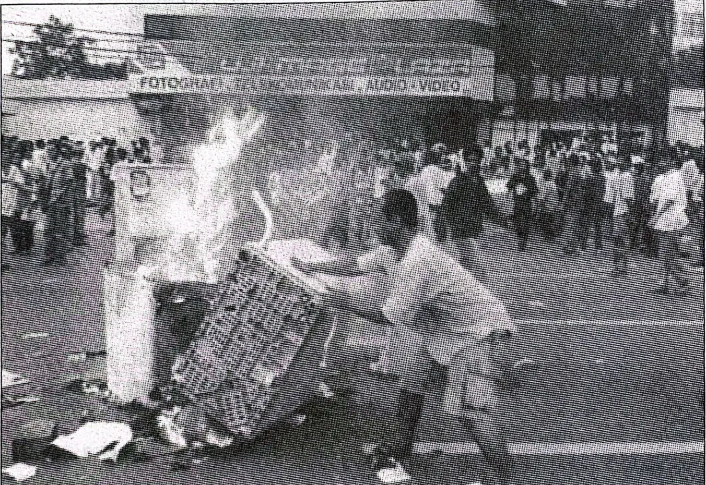

Ketiga, argumen kemiskinan sebagai akar gejala pemerkosaan, dilontarkan sebagai argumen pelarian diri (escapist). Argumen model begini cenderung mengasalkan gejala yang terlalu besar dan jauh, tanpa berupaya mencari penyebab kejadian sebenarnya.

Daripada sibuk berandai-andai, mencari sebab musabab terjadinya kerusuhan dan pemerkosaan massal, adalah lebih baik jika pembongkaran masalah ini difokuskan pada jaringan perencana dan pelaku kerusuhan serta pemerkosaan massal. Pasti ada.

---

# Pemerkosaan di Kota-Kota Lain

<strong>Bukti Kuat Kejahatan yang Terorganisir</strong>

BILA SEJUMLAH PEMERKOSAAN TERJADI DALAM kurun waktu hampir bersamaan di sebuah negeri, pasti ada yang tidak beres dengan negeri itu. Apalagi jika pemerkosaan itu bukan perbuatan kriminal biasa. Sebab, para pelakunya lebih dari satu orang, dan ditujukan pada golongan tertentu dalam masyarakat.

Ini tentu menimbulkan kesulitan dalam menangkap para pelaku. Namun, bukan berarti membiarkan orang-orang biadab itu berkeliaran seenaknya, dan leluasa melakukan pemerkosaan. Hingga laporan ini ditulis (7/8), teror berupa penculikan, pemerkosaan, masih berlangsung—meski tidak lagi massal—tapi dengan modus operandi yang sama seperti kejadian pertengahan Mei lalu.

Fokus perhatian memang agak terpusat ke Jakarta. Maklum, di samping sebagai Ibu Kota Negara, kota ini menanggung korban pemerkosaan paling banyak (mencapai 152 orang, menurut Tim Relawan berdasarkan laporan yang masuk hingga 3 Juli 1998).

Tapi, bukan berarti kekerasan terhadap perempuan yang terjadi di kota-kota lain, dalam waktu hampir bersamaan dengan di Ibu Kota, menjadi terabaikan.

Tim Relawan di daerah-daerah juga tak kalah aktif, menolong para korban pelecehan seksual dan pemerkosaan yang terjadi di wilayahnya. Ternyata, perempuan etnik Tionghoa di Solo, Medan, Palembang, Bandung, dan Surabaya, pun mengalami nasib serupa di Jakarta.

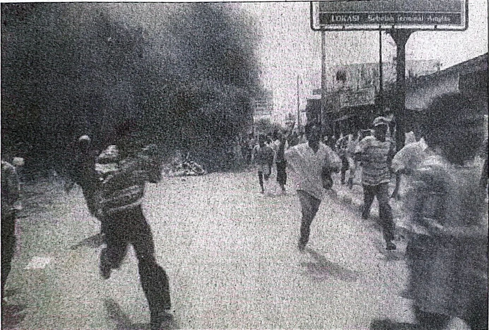

## MEDAN

IBUKOTA PROPINSI SUMATERA UTARA YANG banyak didomisili warga keturunan Tionghoa ini, tak luput menjadi korban pertarungan elit politik. Bahkan, kejadian di sini berlangsung selang beberapa hari setelah kerusuhan 13-14 Mei di Jakarta.

Pada 18 Juni, seminggu setelah ulang tahunnya yang ke-9, Lisa (bukan nama sebenarnya) yang tinggal 20 kilometer di luar kota Medan, memilih pulang sekolah sendiri daripada menunggu Martha, kakaknya. Biasanya sebelumnya, Lisa tak pernah pulang sendiri. Kurang 400 meter dari rumahnya, seorang laki-laki bersepeda motor berhenti dan menawarkan Lisa untuk bonceng.

Dengan polosnya, Lisa menerima tawaran laki-laki itu. Pria yang kita sebut Yudi saja, memang melewati rumah Lisa, tapi tak berhenti. Ia malah membawa Lisa ke kebun tebu dan memerkosanya, sebelum membawa Lisa ke rumah sendiri.

Di rumah Yudi, dengan sepengetahuan istri dan tiga anaknya, ia menyekap Lisa, Gadis kecil keturunan Tionghoa ini dikurung selama 6 hari. “Lisa tidak ingat diperkosa. Namun, ia mengatakan Yudi meracuninya tujuh kali selama pengurungan. Terkadang, Lisa merasakan sakit yang luar biasa saat bangun tidur,” ujar Ekki, ibu Lisa. “Kami yakin, Lisa diperkosa berulang kali.”

Pada pagi 24 Juni, Yudi mengembalikan Lisa ke rumah. Lisa dirawat di rumah sakit selama lebih 10 hari. Ia takut pulang, dan memilih menginap di rumah teman-temannya, ditemani ibu dan dua saudaranya.

Martha mengatakan, penderitaan Lisa bukanlah satu-satunya kasus pemerkosaan di kota itu. “Banyak wanita Tionghoa telah diperkosa atau diserang di sekitar lingkungan ini sejak Mei. Dan sampai sekarang pemerkosaan itu tetap masih berlangsung,” tutur Martha. Bahkan sehari sebelumnya, seorang ibu (56 tahun) etnik Tionghoa juga disetubuhi.

Teror seksual terhadap wanita keturunan Tionghoa di kota-kota besar di Indonesia yang dimulai awal Mei masih berlangsung terus.

Seorang gadis etnik Tionghoa (17 tahun) diculik dalam sebuah taksi. Sedangkan temannya yang tadinya mau ikut pulang bersama, berhasil meloloskan diri. Beberapa hari kemudian, tubuh gadis itu ditemukan mengenaskan. Alat vitalnya penuh dengan pecahan gelas, dan cakaran kuku.

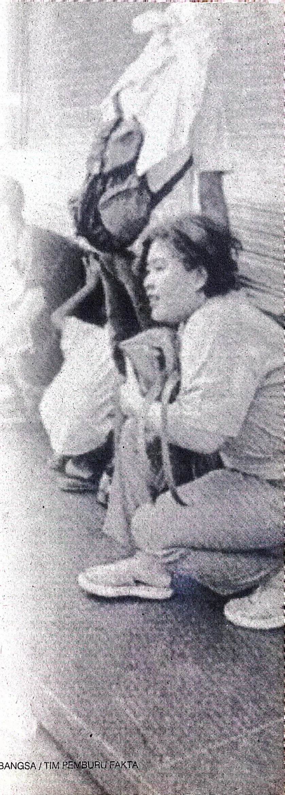

Meski dikatakan telah banyak perempuan menjadi korban, namun di Medan baru lima perempuan yang melapor. Sabaruddin, Ketua Asosiasi Advokat Indonesia cabang Medan, mengatakan ada tiga alasan mengapa masyarakat tidak melaporkan kejadian amoral yang dialaminya.

“Pertama, mereka terlalu malu karena stigma sebagai minoritas. Kedua, mereka tidak tahu ke mana harus melapor, karena mereka tidak lagi mempercayai polisi, dan tidak adanya dukungan kelompok wanita. Alasan terakhir, mereka takut diteror lagi.”

Di samping itu, ada alasan keyakinan. Banyak keturunan Tionghoa di sini beragama Buddha. Ada kepercayaan, mereka yang meninggal sebaiknya dibakar pada hari yang sama dengan saat kematian. Padahal, jasad itu penting sebagai bukti pelaporan ke polisi.

Kampanye menentang kebiadaban di Medan pun tidak berlangsung segencar di Jakarta. Ini antara lain disebabkan, “baru” satu korban pemerkosaan yang dikonfirmasikan meninggal.

## BANDUNG

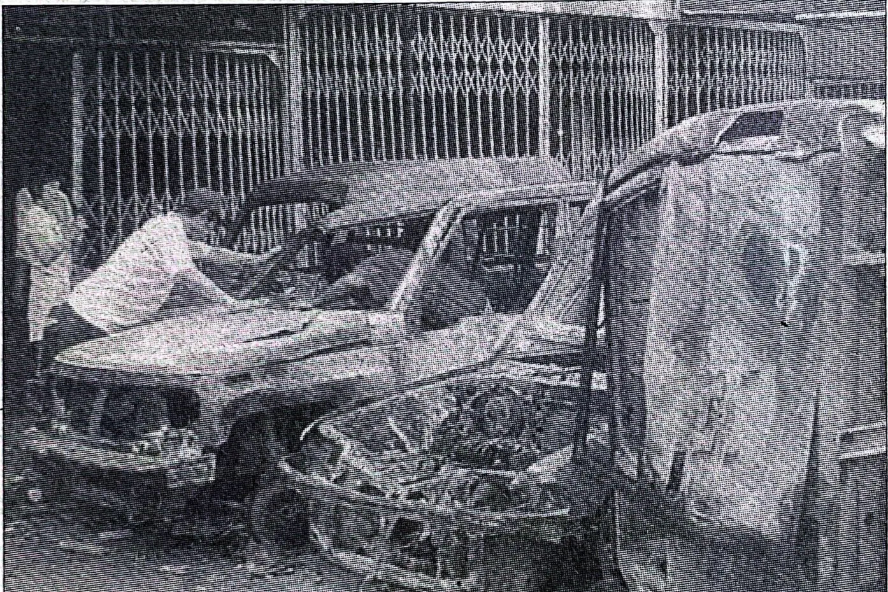

KOTA PARAHYANGAN YANG DIKENAL SEJUK, ramah, bahkan dijuluki Paris van Java, bulan Juli lalu malah menjadi dingin mencekam. Tak ada lagi keindahan dan keramahan. Yang ada hanyalah kecemasan.

Akhir Juli silam, pemilik sebuah rumah makan di Jalan Kelenteng, masih menampakkan kekhawatiran. “Lebih baik jangan ke mana-mana dulu. Kalau tidak penting, lebih baik tidak pergi. Apalagi naik angkot (angkutan kota),” tutur pria setengah baya itu.

Ia enggan memberitahu lebih jauh mengenai pemerkosaan yang terjadi di kotanya. Kendati demikian, ia mengaku tahu kasus pemerkosaan yang kebetulan dialami kenalan dekatnya.

Ketidakpercayaannya terhadap orang lain mungkin beralasan. Pasalnya, rumah makannya pernah didatangi 30. orang tak dikenal. “Kelihatannya, mereka bukan dari Bandung,” katanya. Setelah menyantap makanan yang dipesan, “Mereka pergi begitu saja. Tidak bayar,”tambahnya.

Kasus pelecehan seksual dan perkosaan di Bandung tercatat meningkat pada Juli lalu. Teror anti Cina terus berdengung. Tercatat sekurangnya delapan kasus pelecehan seksual dan pemerkosaan dalam tiga minggu terakhir

Sepasang muda-mudi yang sedang melintasi jalan, tiba-tiba dihentikan. Si pria dipukuli. Sementara gadisnya diculik dan diperkosa ramai-ramai di suatu tempat. Para pelaku dengan ringan berseloroh, “Sekarang nih kesempatan menikmati amoy-amoy Bandung."

Gadis tersebut, setelah diperkosa, dianiaya. Alat vitalnya dirusak dengan besi. Gadis itu lalu dirawat di sebuah rumah sakit di Bandung.

Lea Margareth, salah seorang peng urus Panpuri (Pandu Putri Pertiwi), bersama para mahasiswa Kota Kembang dan ibu-ibu rumah tangga, pada 24 Juli menemui Komandan Kodim Bandung, Letkol. Anhar.

Mereka melaporkan, dalam kurun tiga minggu di bulan Juli, diperoleh fakta-fakta dan berita-berita yang meresahkan masyarakat kota Bandung, terutama warga etnik Tionghoa.

Fakta-fakta tersebut jelas merupakan bentuk-bentuk ancaman teror terhadap rakyat. Paling tidak, ada delapan fakta dan berita buruk yang berhasil diperoleh Panpuri selama bulan lalu.

Pertama, ditemukan selebaran yang beredar di daerah Kopo, Cicaheum, dan Tamansari. Isi selebaran gelap itu, mengajak warga masyarakat, terutama golongan ekonomi lemah, untuk melakukan penjarahan, kerusuhan, dan kekerasan terhadap warga Tionghoa di Bandung.

Kedua, empat mahasisiwi Universitas Parahyangan (Unpar), pada waktu yang berbeda mengalami pelecehan seksual. Mereka dikejar-kejar beberapa oknum di dekat kampus Unpar, Jl. Ciumbeuluit. Untung warga masyarakat setempat berhasil menyelamatkan keempat gadis itu dari nafsu binatang, sehingga terhindar dari perlakuan yang lebih buruk.

Ketiga, akhir Juni lalu seorang mahasiswi ilmu ekonomi diperkosa beberapa pria. Gadis itu disetubuhi di suatu tempat di Soreang. Korban kemudian dirawat di sebuah rumah sakit di Bandung.

Keempat, seorang mahasiswi diperkosa, setelah ia mengambil uang dari sebuah ATM.

Kelima, beberapa “tukang becak” misterius di Jl. Astana Anyar dan Jl: Kopo, mengaku memperoleh uang sebesar Rp 5.000-Rp. 25.000 dari orang tak dikenal. Para penerima uang itu diperintahkan untuk melakukan pemerkosaan terhadap para perempuan etnik Tionghoa.

Keenam, empat karyawati sebuah bank swasta juga diperkosa di tempat-tempat terpisah. Di antara empat korban itu, ada seorang ibu yang telah beranak dua orang.

Ketujuh, adanya telepon gelap yang bertubi-tubi terhadap beberapa warga Tionghoa di Bandung. Isinya, ancaman kekerasan yang menimbulkan keresahan.

Kedelapan, ancaman secara personal, sambil meneriakkan perkataan yang bersifat rasial. Selain fakta-fakta dan berita-berita tersebut, Panpuri juga menemukan dampak-dampak buruk yang diderita langsung oleh warga masyarakat, terutama mereka yang jadi sasaran teror.

Akibat buruk teror tersebut antara lain, warga keturunan Tionghoa merasa tidak nyaman lagi hidup di Bandung. Timbul rasa tidak aman, selalu dibayang-bayangi ketakutan akan adanya kekerasan. Hal ini mengakibatkan, warga masyarakat tidak dapat menjalani kegiatan sehari-hari dengan tenang.

## SOLO

KOTA DI JAWA TENGAH INI MENGALAMI KERUSUHAN pada saat yang sama dengan kerusuhan di Jakarta. Kerugian materi akibat kerusuhan yang meluluhlantakkan pusat kota ini, diperkirakan mencapai Rp 457 miliar.

Itu baru kerugian materi. Belum lagi kerugian psikologis. Yang tak ternilai dengan kurs uang negara manapun di dunia. Seorang tim relawan di kota ini mengaku, belum bisa memberi banyak bantuan kepada para korban pemerkosaan.

“Memang ada beberapa laporan yang masuk, tapi kami mengalami kesulitan mengeceknya. Misalnya laporan pemerkosaan di daerah Colomadu, yang korbannya dua hari tak sadarkan diri. Kami gagal melacak, karena keluarganya menutup diri,” kata sang relawan.

Korban yang diduga diperkosa, menurut relawan itu, adalah ibu dan anak. Ibu itu masih tergolong muda, sekitar 25 tahun usianya, dan anaknya masih pelajar SMP. Ketika massa masuk ke rumah, si ibu yang sudah di luar rumah, masuk lagi untuk menolong anaknya. Tapi, malah si ibu maupun anaknya tak muncul-muncul dari dalam rumah.

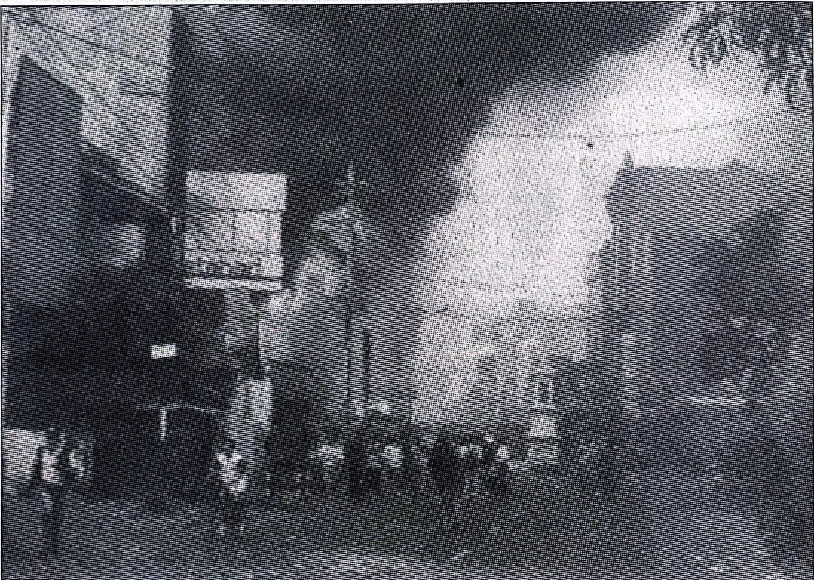

Dan, begitu mereka keluar dari rumah, menurut kesaksian orang yang melihatnya, keduanya dalam keadaan mengenaskan dan tampak stres berat. Tak lama kemudian, si anak tidak sadarkan diri.

Ada juga informasi yang sampai kepada tim relawan, bahwa di kawasan Jalan Slamet Riyadi, ada dua wanita Tionghoa diperkosa dalam sebuah gang. “Waktu kami datang pertama kali kepada yang memberi informasi, mereka tidak terbuka,” ujar sang relawan.

Gambaran Solo di waktu malam seperti syair lagu keroncong—ramai, damai, dan romantis—tak lagi ditemukan. Solo di waktu malam, dua bulan setelah kerusuhan lewat, masih seperti kota mati. Kesunyian semakin terasa di semua sudut kota yang berpenduduk 550.000 orang, di atas lahan seluas 44 kilometer persegi.

Sumber kesunyian terutama, tampaknya bukan karena pusat keramaian belum dibangun lagi. Tapi, lebih terutama pada teror pertengahan Mei itu masih begitu mencengkeram seluruh warga.

Ada kesan, kini tak mudah bertemu dengan warga keturunan Tionghoa di jalan-jalan. Orang menduga, bila mereka tak mengurung diri di dalam rumah, ya mengungsi keluar kota.

Menurut catatan Tim Relawan setempat, korban pemerkosaan etnik Tionghoa di sini mencapai 24 orang. Kelihatannya kecil. Tapi sebetulnya besar jika dilihat dari prosentase penduduk. Bandingkan misalnya dengan Jakarta (152 korban), tapi dari 8,5 juta penduduk dan lahan seluas 660 kilometer persegi.

Seperti di Jakarta, penjarahan dan pemerkosaan di Solo dilakukan dengan cara terorganisir dan sistematis. Akibat kerusuhan itu, menurut Yayah Khisbiyah MA, psikolog, timbul perasaan tertekan, was-was, rasa tidak aman baik secara kolektif maupun individual.

## SURABAYA

INVESTIGASI TIM RELAWAN YANG TERGABUNG dalam LSM Gema Sukma, berkaitan dengan pemerkosaan di Surabaya, sampai laporan ini ditulis, membuahkan hasil 19 orang diperkosa, dan 6 perempuan dilecehkan.

“Total korban ada 25 orang,” kata salah seorang aktivis Gema Sukma. Data tersebut didapat dari komunitas para korban, orang dekat korban, serta pengakuan korban langsung. “Ini riil,” tegasnya.

Setidaknya, ada tiga korban yang sudah berbicara langsung pada tim investigasi. Korban yang mau membuka diri kepada tim itu mensyaratkan, hanya mau bicara lewat telepon.

Bila para korban tersebut tak bersedia membuka diri kepada umum, itu lebih disebabkan tidak ada jaminan keamanan bagi mereka. Contohnya, kasus pemerkosaan di Jakarta. “Ketika ada seorang korban yang siap blak-blakan, tetapi kemudian lenyap tak diketahui nasibnya,” ujar sang aktivis.

Sementara itu, Kapolresta Surabaya Timur Letkol Oegroseno menegaskan, tidak menutup kemungkinan adanya pemerkosaan itu. “Kemungkinan masih ada. Tapi laporan intel, sampai saat ini (Juli) yang ada baru sebatas pelecehan,” papar Oegro.

Tindakan perkosaan di beberapa kota telah terjadi, memang. Satu pertanyaan yang tak mungkin diredam, apa yang harus dilakukan terhadap jaringan rencana operasi serta perencana pelaku perkosaan massal?

Dilupakan, mungkin kata yang sangat tidak pas untuk para korban. Sebab, para korban, keluarga, kerabat mereka, bahkan saksi-saksi mata, telah mengalami dan melihat peristiwa yang tak akan mungkin dilupakan seumur hidup. Jaringan kejahatan publik yang sistematis-terorganisir ini harus dihadapi, bukan dihindari.

<em>dari berbagai sumber</em>

---

# Jerit itu Tanpa Suara

<strong>Korban-Korban Mengenaskan</strong>

MEI PERTENGAHAN YANG KELABU. SEBAGIAN Jakarta hangus terbakar. Puing-puing hitam legam berserakan, seakan menutupi peristiwa paling kelam dalam sejarah bangsa ini di tahun 1998. Realita dan impian, kini tiada batas lagi.

Penjarahan, perusakan, dan pembakaran, mungkin belum seberapa bila dibandingkan dengan harga diri yang terkoyak dalam kepiluan mengenaskan. Betapa tidak. Ratusan perempuan etnik Tionghoa telah menjadi korban pelecehan seksual dan perkosaan massal paling biadab.

Ketika rumah-rumah atau toko-toko mereka dijarah dan dibakar pada 13-14 Mei silam, masa depan pun ikut terkubur bersamanya.

Mereka tidak saja dilecehkan atau diperkosa, tapi ada pula yang dicekik, dibunuh, bahkan bunuh diri. Bagi yang masih hidup, peristiwa tersebut akan menjadi pengalaman traumatik yang paling menyiksa jiwa dan raga. Martabat, nama baik, keluarga, sahabat, juga kekasih, lenyap seketika. Yang ada cuma kekosongan tanpa harapan.

Hanya dalam dua hari itu, dilaporkan telah terjadi 152 peristiwa pemerkosaan di Jakarta. Dari jumlah itu, ada dua puluh korban pemerkosaan yang tewas. Sebagian dibunuh setelah diperkosa, sedangkan lainnya bunuh diri karena tak kuasa menanggung aib.

Pantaslah kita berkabung bagi derita tak terperi ini. Hidup laksana kuburan maha gelap, denyut kehidupan berubah menjadi tragedi tiada akhir. Inilah derita kaum perempuan, derita manusia yang tercabik-cabik harga dirinya.

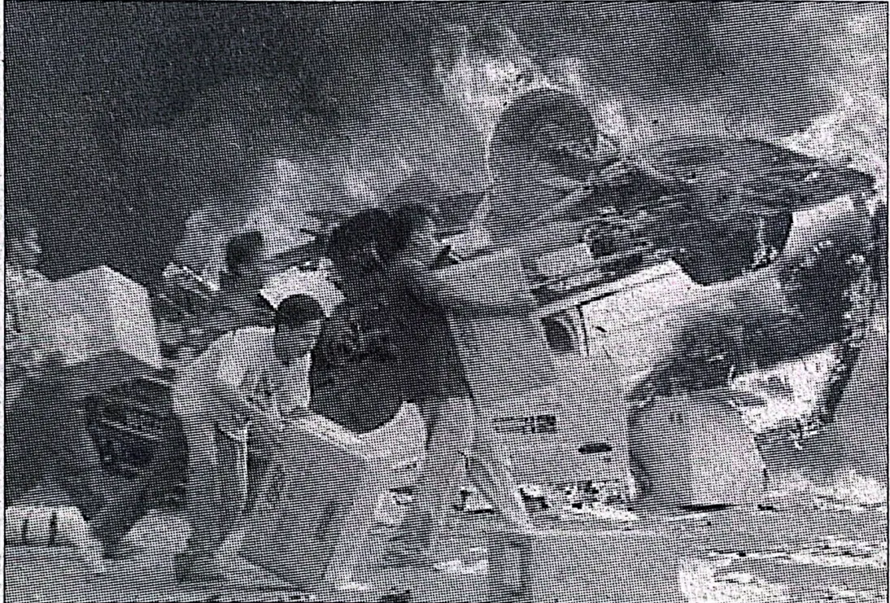

Marilah kita asah nurani yang mulai tumpul. Melihat jujur tanpa perbedaan apa pun. Renungkanlah kisah-kisah yang menyayat hati ini:

- Hari itu, 13 Mei 1998, puluhan pemuda yang diturunkan dari dua truk menyerbu sebuah ruko. Mereka menjarah barang, menyeret, dan.melucuti pakaian dua perempuan usia 15 dan 20. Kemudian mereka memerkosanya beramai-ramai. Usai melampiaskan hasrat hewani, sebagian lainnya lantas membakar ruko, dan membiarkan kedua korban tersebut terbakar hangus di dalamnya.
- Di hari yang sama, sekelompok orang tak dikenal merusak dan menjarah rumah keluarga etnik Tionghoa lainnya. Sebagian mereka memaksa anak lelaki keluarga itu memerkosa adik perempuannya yang berusia 26 tahun. Jika tak mau melakukannya, rumahnya akan dibakar.

Masih belum puas, mereka juga memaksa pembantu lelaki korban untuk memerkosa nyonya majikannya yang berumur 50 tahun. Kemudian tindak pemerkosaan dilanjutkan oleh orang-orang tak dikenal itu.

Akhirnya, rumah korban dibakar juga. Kakak beradik itu dilemparkan ke dalam kobaran api. Sang ibu menyusul membakar diri.

- Pada 13 Mei itu pula, puluhan pemuda turun dari dua truk. Mereka menyerbu ruko, menjarah, memerkosa, dan menggigit puting payudara (maaf - Red.) seorang perempuan usia 17 tahun hingga putus. Setelah itu mereka membakar rukonya. Beruntung, korban berhasil lari menyelamatkan diri.
- Kisah A lain lagi. Gadis berusia 26 tahun ini pada hari naas itu, Rabu, 13 Mei 1998, pulang dari kantornya—sebuah bank swasta. Ia dibonceng pacarnya, pegawai perusahaan komputer, menuju rumah. Merasa keadaan sudah mereda, mereka nekat pulang menjelang pukul 21.00 WIB. Keduanya tidak pernah bermimpi, dalam perjalanan itu, di suatu tempat di Jakarta Barat, mereka akan dikepung massa yang muncul begitu saja entah dari mana. Di keremangan malam itu, ia tidak mampu lagi berpikir tentang perlakuan apa saja yang telah diterimanya. Yang teringat hanyalah, ia ditarik-tarik massa agar turun dari sepeda motor. "Tuhan, tolong Tuhan ...," cuma kata-kata itu yang bisa ia teriakkan di tengah-tengah himpitan kepanikan dan ketakutan luar biasa. Blazernya sudah terlepas. Sementara seluruh harta miliknya dilolosi. Uang, telepon genggam, kartu ATM, SIM, STNK, helm, bahkan obat dokter untuk orang tuanya yang baru ditebus di apotek pun habis dijarah. Gadis itu tidak ingat lagi, diapakan saja dirinya waktu itu. Hanya doa yang terus menguatkannya. Sekali ia jatuh terjengkang. Tetapi dengan kekuatan yang tersisa, ia bangun dan kembali memegang baju pacarnya erat-erat. Sang pacar, yang orang tuanya berencana melamar tanggal 17 Mei—empat hari setelah kejadian ini—tak berdaya dipukuli massa. Yang terdengar hanyalah rintihannya, "Ampun, Pak ... ampun. Saya orang biasa ..."

Sementara itu, teriakan massa kian menyeramkan. Tetapi, dalam keputusasaan, tiba-tiba seseorang berusia lanjut muncul. Dialah yang memerintahkan agar para penjarah membebaskan kedua anak manusia itu. Mereka segera pergi meninggalkan tempat tersebut, sebelum kemudian ditolong polisi jaga di dekat tempat kejadian, yang juga tak luput dari lemparan batu massa. Oleh polisi, mereka diantar ke rumah penduduk. Seorang penduduk lalu memboncengkan keduanya sampai ke rumah. Selama berhari-hari si gadis masih saja dicekam peristiwa itu. Lama ia tak masuk kantor. Sekujur tubuhnya penuh bilur-bilur biru, bahkan juga di pangkal paha. Bekas-bekas kekerasan itu baru hilang seminggu kemudian.

- Sehari setelahnya, 14 Mei 1998, pemerkosaan kian merebak. Sekelompok orang tak dikenal memasuki sebuah ruko dan menjarah barang-barang. Sebagian lainnya menelanjangi R, dan memaksanya menyaksikan kedua adiknya diperkosa. Usai disetubuhi secara paksa, kedua gadis itu (M dan I) dilempar ke lantai bawah yang sudah mulai terbakar. Keduanya tewas. Namun, R berhasil selamat karena ada yang menolong.
- Kejadian memilukan, juga menimpa gadis kecil usia 11 tahun. Pada 14 Mei 1998, puluhan pria dewasa tak dikenal merusak rumah korban sambil tak lupa menjarahnya. Dengan biadab, mereka melucuti pakaian korban, memperkosa, dan merusak alat vitalnya dengan kawat berduri. Gadis kecil itu mati muda di rumah sakit. Seorang korban lain dan keluarganya mengungsi karena merebak isu akan meletusnya aksi mahasiswa dan kerusuhan. Karena peristiwa tersebut tak terjadi, korban dan keluarganya kembali ke rumah. Namun, malang tak dapat ditolak. Saat mereka merasa aman berada di rumah sendiri, mimpi buruk menjemput ketenangan di hari 14 Mei. Puluhan pemuda tak dikenal berpenampilan kumuh dan berwajah dingin, menyerbu kediaman keluarga itu dan menjarahnya. Delapan orang di antaranya menyeret, melucuti pakaian, dan memerkosa perempuan yang baru berumur 23 tahun itu selama 2 jam.
- Seorang ayah tak dapat berbuat banyak saat mendapati kenyataan, anak gadisnya yang berusia 18 tahun diperkosa di sebuah jalan kawasan Jembatan Lima. Sang anak disetubuhi dari depan dan belakang oleh segerombolan orang. Tubuhnya yang lunglai segera dilarikan ke rumah sakit. Namun, kerusakan parah di sekitar rahim, membuat putri ini akhirnya menghembuskan napas terakhir dalam perjalanan.
- Di lain tempat, sekelompok orang tak dikenal datang menyerbu rumah seorang korban, merusak, dan menjarahnya. Sebagian lainnya menyeret korban, memperkosa, dan menusuk alat vitalnya dengan pecahan botol kaca. Korban meninggal di sebuah rumah sakit di Singapura. Peristiwa mengenaskan yang menimpa gadis usia 9 tahun itu juga terjadi pada 14 Mei 1998.
- Kejadian tragis, menimpa seorang ibu muda yang sedang hamil 4 bulan. Sekelompok orang tak dikenal mendobrak ruko, dan menjarah barang-barangnya. Sebagian lainnya menarik dan melucuti pakaian korban. Suami korban yang berusaha menolong, dipukul oleh para perusuh. Dalam keadaan tanpa busana, korban berhasil meloloskan diri dan lari. Malang, ketika menuruni tangga, korban terjatuh. Kakinya patah dan kandungannya gugur. Ibu muda itu meninggal di rumah sakit, akibat pendarahan hebat. Sang suami pun kehilangan segalanya.
- Di saat itu pula, puluhan orang menghancurkan ruko milik sebuah keluarga dan mengancamnya. Kakak beradik yang berusia 19 dan 21 tahun, kemudian diperkosa bergantian oleh 7-10 orang. Ruko dibakar, dua bersaudara itu dilempar ke api, dengan disaksikan orang tuanya.
- Masih di tanggal 14 Mei, sebuah ruko lain diserbu puluhan orang tak dikenal. Sebagian menjarah barang, sebagian lagi memperkosa ibu (40) dan dua gadisnya (15 dan 18). Karena tertekan, salah seorang gadis itu melompat dari jendela dan tewas seketika. Ruko kemudian dibakar, ibu dan seorang gadisnya yang masih hidup, berhasil menyelamatkan diri.
- Selang satu hari kemudian, pada 15 Mei 1998, pukul 6 sore, sekelompok orang tak dikenal memasuki kompleks perumahan kawasan Bekasi. Sebagian menjarah barang, sebagian lagi melucuti pakaian korban, dan memaksanya menari-nari di atas ranjang. Suami korban yang berusaha menolong, diseret, dipukul, dan dibacok punggungnya. Seorang tetangga yang ikut menolong, juga ditusuk hingga tewas. Anak korban yang berusia 3 bulan, berhasil diselamatkan oleh tetangga, sementara rumah korban dibakar.Korban, seorang ibu rumahtangga,. sekarang kehilangan ingatan dan dirawat di rumah sakit jiwa. Kini setiap hari ia hanya mau mengenakan kaos singlet dan rok lebar. Rok lebar itu selalu disingkap dan dikibas-kibaskannya ke atas. Ia kerap mengoceh, "Saya mau menari ... telanjang juga mau, kok! Saya enggak malu!" Jika ada laki-laki menjenguknya, ia selalu menunjuk-nunjuk mereka dan berkata, "Itu dia tuh yang suruh saya telanjang. Itu dia tuh yang suruh saya nari!" Sang suami kini sudah keluar dari rumah sakit tempat ia dirawat. Laki-laki itu mulai sembuh dari luka bacok di punggungnya, kendati masih terlihat memar bekas-bekas pukulan di tubuhnya, dan luka pada kepalanya. Ia setia menunggui istrinya, walaupun tangis kepiluan dan kesedihan belum bisa terhapus dari hatinya.

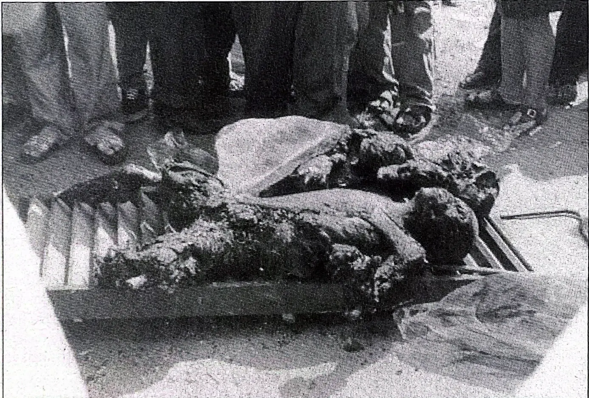

- Di sebuah rumah sakit terbesar dan ternama di Singapura, seorang gadis tampak termenung-menung. Kadang ia menangis meratapi nasibnya. Begitulah kelakuannya sehari-hari. Saat ini ia sedang dirawat di bagian psikiatri. Gadis itu baru 18 tahun. Tapi, ia telah mengalami peristiwa dahsyat yang merusak hidupnya: dia diperkosa. Peristiwa sadis yang terjadi pertengahan Mei di Jakarta itu membuat berat badannya langsung turun 10 kilogram dalam 7 hari, karena mengalami shock maha berat dan tidak mau makan. Setiap hari kerjanya hanya menangis. Dan bila si gadis menangis, kedua orang tuanya pun tak kuasa menahan air mata. Mereka ikut meratapi nasib anak gadisnya. Beberapa perawat dan dokter di rumah sakit itu geram dan ikut bersedih atas musibah tersebut. Menurut ayahnya, anak gadisnya itu diseret keluar rumah dan diperkosa beramai-ramai oleh sekitar 10-15 orang. Ayah, ibu, dan adiknya yang masih kecil menyaksikannya. Ketika ayah dan ibunya meratap memohon agar anak gadisnya dilepaskan, pakaian si ibu malah dirobek-robek. Ia ditelanjangi serta dipukuli beramai-ramai. Bahkan mulut ibu tersebut diganjal dengan tongkat kayu. Anak gadisnya yang berteriak-teriak, diseret-seret seperti binatang. Para pemerkosa itu bersorak senang, bagai melihat tontonan menarik dan mereka memperkosanya lagi. Gadis itu benar-benar shock. Ia masih menderita pukulan serta hinaan. Lengan kirinya luka berdarah sepanjang 15 sentimeter, payudaranya yang sebelah kiri luka memar serius, dan puting buah dada kanannya (maaf-Red.) dirusak oleh senjata tajam. Ibu si gadis juga luka-luka di sekujur tubuhnya, serta luka berdarah di sekitar buah dada dan dada bagian atas. Menurut sang ayah, tetangganya pun diperkosa. Setelah si tetangga diperkosa, bagian terlarangnya ditusuk dengan kayu hingga berdarah dan menjerit-jerit. Sungguh memilukan.
- Cerita lain, ketika para pegawai pulang naik bis, di dalam bis para penumpang dipilah-pilah. Para penumpang perempuan etnik Tionghoa disuruh turun, diminta membuka baju, dan jalan berbaris. Mereka digiring ke padang ilalang di pinggir jalan dan dipilah-pilah lagi. Yang berparas cantik diperkosa, sedangkan yang tidak begitu cantik disuruh berjalan telanjang. Begitulah perlakuan tanpa nurani yang mereka terima.
- Seorang korban yang lolos dari usaha perkosaan bercerita. Ketika ia naik bis di daerah Jakarta Barat, bisnya dihentikan massa. Semua penumpang disuruh turun. Kebetulan ia berada di belakang seorang ibu yang berkulit putih. Saat itulah ada yang berteriak, "Serbu ibu itu, perkosa!" Walau ketakutan, si ibu berkata cepat, "Anda salah lihat. Saya orang Batak!" Lalu ibu itu mengeluarkan KTPNYA. Melihat itu, orang tadi berteriak, "Kalau begitu, perkosa wanita yang di belakangnya." Gadis bermata sipit itu tampak ketakutan sekali. Untunglah si ibu membelanya, "Ia keponakan saya, jangan diperkosa." Akhirnya, gadis tersebut lolos dari pemerkosaan karena dibawa pergi ibu itu.

Ada lagi cerita sedih. Sebanyak sepuluh orang perusuh memasuki sebuah bank dan menutup pintu bank tersebut. Sekitar sepuluh karyawati etnik Tionghoa disuruh menari-nari tanpa busana.

- Perbuatan biadab seperti itu bukan saja terjadi di dalam ruangan, tapi juga di luar kantor atau rumah, bahkan di tempat umum. Inilah kisah tragis dari tiga korban pemerkosaan pada saat peristiwa kerusuhan terjadi di Jakarta, pertengahan Mei silam. Tiga orang perempuan terdiri dari ibu, anak, dan adiknya, naik mobil dengan menyetir sendiri dari Bandung ke Jakarta untuk membeli stok pakaian. Namun, nasib sial menimpa mereka. Ketika kendaraannya melaju di Jalan Tol Cikampek, sekelompok massa menghadang keluarga tersebut. Si ibu yang menyetir, berhenti. Orang-orang tak dikenal itu kemudian menyuruh mereka turun sambil mengatakan, bahwa Jakarta sedang rusuh. Tapi, apa yang terjadi kemudian? Massa yang tampak beringas dan tak diketahui arah datangnya itu, serta merta menggulingkan mobil sedan tersebut dan membakarnya. Ketiga perempuan tersebut kaget dan berteriak minta tolong. Namun, kendaraan yang datang dari arah Bandung maupun dari Jakarta langsung berbelok arah lagi, ketika melihat api mulai melumat kendaraan itu. Mulanya ketiga perempuan tersebut, sebut saja Nuri (47), Yuli (43), dan Yati (25), tak mengira peristiwa itu bakal terjadi. Ketika mobilnya dibakar, mereka berusaha mencari perlindungan dengan cara mencari jalan keluar tol lewat semak-semak di pinggirnya. Tapi, beberapa orang menghampiri mereka. Serta merta mereka mendengar ancaman menyuruh berhenti. Kalau tidak, akan dibunuh. Mereka pun tidak dapat berbuat banyak, ketika sejumlah laki-laki beringas menggarap mereka di pinggir jalan tol, yang waktu itu dalam keadaan gelap. Cahaya api dari arah kendaraan terbakar tidak sampai ke situ karena terhalang benteng pembatas jalan tol. Dari ketiga perempuan tersebut, Yati gadis yang tengah mekar ini—menerima perlakuan sangat tidak manusiawi. Selain ditelanjangi, ia digilir beberapa orang. Sedangkan Nuri dan Yuli hanya dirobek-robek celananya, sementara rok mereka masih tetap utuh. Meski mereka diperlakukan sadis seperti hewan, namun ketiganya berhasil menyelamatkan diri. Nyawa mereka selamat, berkat bantuan para penduduk setempat. Akhirnya, mereka bisa sampai ke rumah keesokan harinya.
- Seorang pelajar diangkut dari terminal bis, saat ia menanti angkutan umum itu untuk pulang ke rumah. Empat pria di dalam mobil menawari jasa baik. Ternyata, gadis itu malah disetubuhi beramai-ramai di daerah rawa-rawa dekat Bandara. Melihat ada seragam dinas di dalam mobil, si gadis memberanikan diri berkata, "Jika Bapak-Bapak petugas keamanan, seharusnya Bapak-Bapak melindungi saya." Salah seorang di antara pelaku dengan ringan menjawab, "Tidak. Saya harus memberimu pelajaran. Sebab kamu perempuan, cantik, dan orang Cina."
- Sebuah keluarga muda berniat mengungsi ke luar Jakarta saat terjadi kerusuhan. Namun, dalam perjalanan ke bandara Soekarno-Hatta, Cengkareng, mobil mereka dicegat segerombolan orang. Sang suami yang mengemudikan mobil dipukuli. Sementara istrinya ditelanjangi, dan diperkosa beramai-ramai. Dan.... putri mungilnya yang baru berusia dua tahun tak lepas dari keberingasan massa. Alat vitalnya dirusak dengan benda tajam. Kini, sang ibu hanya termangu-mangu sepanjang hari, merenungi nasib.
- Yang tak kalah memilukan, pengalaman seorang gadis usia 16 tahun. Ia diperkosa beramai-ramai. Peristiwa itu begitu membekas dalam dirinya. Kini ia mengalami trauma berat. Setiap malam ia sering terbangun, berteriak-teriak, atau menangis tanpa sebab. Orang tuanya kemudian memasukkannya ke sebuah rumah sakit swasta di Jakarta. Namun malang, ketika dokter diminta untuk melakukan tes kehamilan pada si gadis, ternyata hasilnya positif. Hal ini menimbulkan dilema bagi dokter tersebut. Ia meminta orang tua si gadis memberitahukan kabar buruk itu kepada anaknya. Begitu mendengar berita mengenai kehamilannya, gadis tanggung itu langsung menangis dan menjerit-jerit histeris.

KEJADIAN-KEJADIAN SADIS MENGENASKAN seperti di atas, hanyalah sebagian dari sedikit kasus yang baru terungkap. Tentu masih banyak pengalaman pahit yang belum tersingkap.

Memang, Tim Relawan telah membuka layanan "hotline" bagi korban yang ingin mengadukan nasibnya. Mereka menampung pengaduan para korban perkosaan lewat nomor telepon: 021-790 2109 atau 021-790 2112.

Sejak adanya layanan itu, setiap hari sekitar 25 laporan masuk ke sana. Ratusan kasus perkosaan bulan Mei itu perlahan-lahan terkuak. Meski tak dimungkiri, masih ada rasa takut dan malu pada diri para korban.

Mereka kerap mengurungkan niat untuk mengungkap derita yang luar biasa itu. Belum lagi adanya teror, baik melalui telepon maupun surat kaleng, yang mengancam keselamatan jiwa dan keluarganya.

Jumlah total korban pemerkosaan dan pelecehan seksual massal yang melapor sampai 3 Juli 1998 adalah 168 orang (152 dari Jakarta dan sekitarnya, 16 dari Solo, Medan, Palembang, dan Surabaya).

Sampai saat ini, korban pemerkosaan yang diidentifikasi berusia 12 hingga 55 tahun. Namun, ternyata ada juga anak berusia di bawah lima tahun (balita) yang mengalami kekerasan seksual. Di samping kisah gadis cilik usia dua tahun di atas, Bakom PKB mencatat, ada perempuan berumur 3 tahun yang diperkosa di depan ayahnya.

Tidak hanya etnik Tionghoa kelas menengah dan atas yang menjadi korban kekejian. Tim Relawan mendapati tiga anak gadis usia belasan tahun dari sebuah keluarga miskin di Jakarta Utara, yang digilir tujuh pemerkosa.

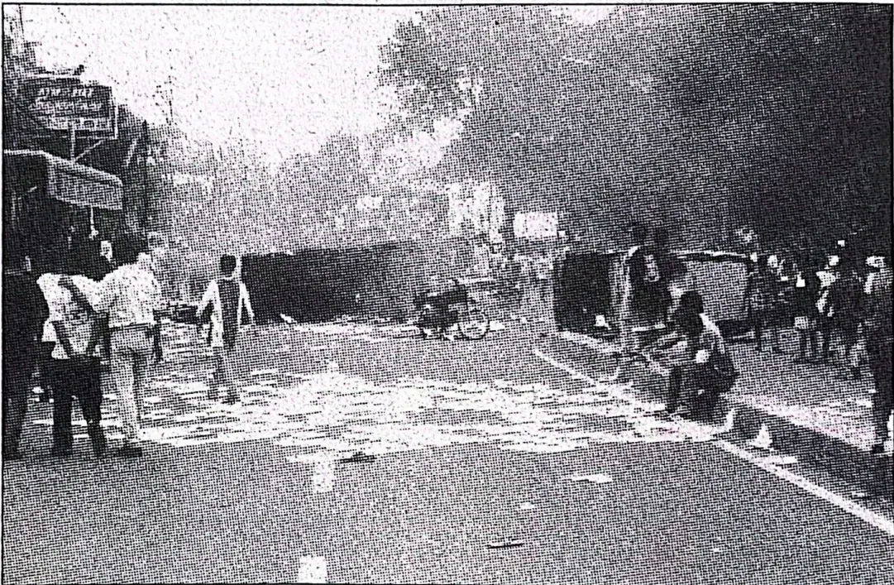

RENTETAN PERISTIWA MEMILUKAN ITU MEMANG telah meninggalkan luka mendalam di hati para korban, keluarga, dan handai taulannya. Juga menggoreskan kepedihan yang ngilu di hati kita sebagai manusia beradab. Semoga kejadian pahit ini tidak terulang lagi di kemudian hari.

<em>dari berbagai sumber</em>

---

# Noda Hitam dalam Lembar Kehidupan

<strong>Dampak Luas Pemerkosaan</strong>

BERBAGAI TINDAK PEMERKOSAAN YANG MARAK berlangsung pertengahan Mei silam, bagaikan mimpi buruk di siang hari. Peristiwa pilu tersebut meninggalkan bekas mendalam di hati kita.

Penderitaan ini memang sangat panjang bagi yang mengalaminya, juga buat keluarga mereka. Simaklah derita seorang ayah, yang putrinya diperkosa.

Di sebuah rumah mewah, seorang lelaki setengah baya itu tinggal bersama keluarganya. Tak ada ekspresi di wajahnya. Tatapannya tampak kosong melompong.

Ketika ditemui, laki-laki itu menutup mukanya dengan kedua telapak tangan. Badannya bergetar hebat. Setelah itu ia berteriak keras, "Biadaaabb! Biadaaabbb! Kenapa anakku yang jadi sasarannya? Apa salah kami? Apa salah kami?" Ia berteriak, dan terus masuk kembali ke kamarnya. Jiwanya kelihatan sangat tergoncang.

Menurut seorang pembantunya, lelaki itu sering berteriak di malam hari. Terkadang ia mencaci maki dan berteriak-teriak keras minta tolong. Ia pun jarang makan, lebih sering minum air putih.

Apa kasus yang menimpa putrinya, sehingga lelaki yang agak kurusan itu begitu tertekan? Menurut sumber yang layak dipercaya, pria itu stres lantaran anak gadisnya diperkosa di depan matanya sendiri selama berjam-jam pada 14 Mei 1998.

Hari itu, pagi-pagi sekali ia telah berangkat kerja di Jalan Sudirman, Jakarta Pusat. Karena mendengar akan ada kerusuhan besar-besaran, maka ia pun segera pulang ke rumah. Dia sangat mengkhawatirkan anak gadisnya yang masih bersekolah di SMA.

Setiba di rumah, ia melihat putrinya dan anak lainnya sudah pulang. Ia memperingatkan anak-anaknya agar tidak keluar rumah, karena banyak sekali orang di jalanan yang tengah mengamuk.

Tidak berapa lama kemudian, massa mulai bergerombol di depan rumah mereka. Orang-orang itu berteriak-teriak, "Itu rumah Cina, itu rumah Cina." Mereka bagai dikomando untuk menyerbu beberapa rumah di kawasan itu. Memang, yang diserbu hanyalah rumah-rumah warga etnik Tionghoa.

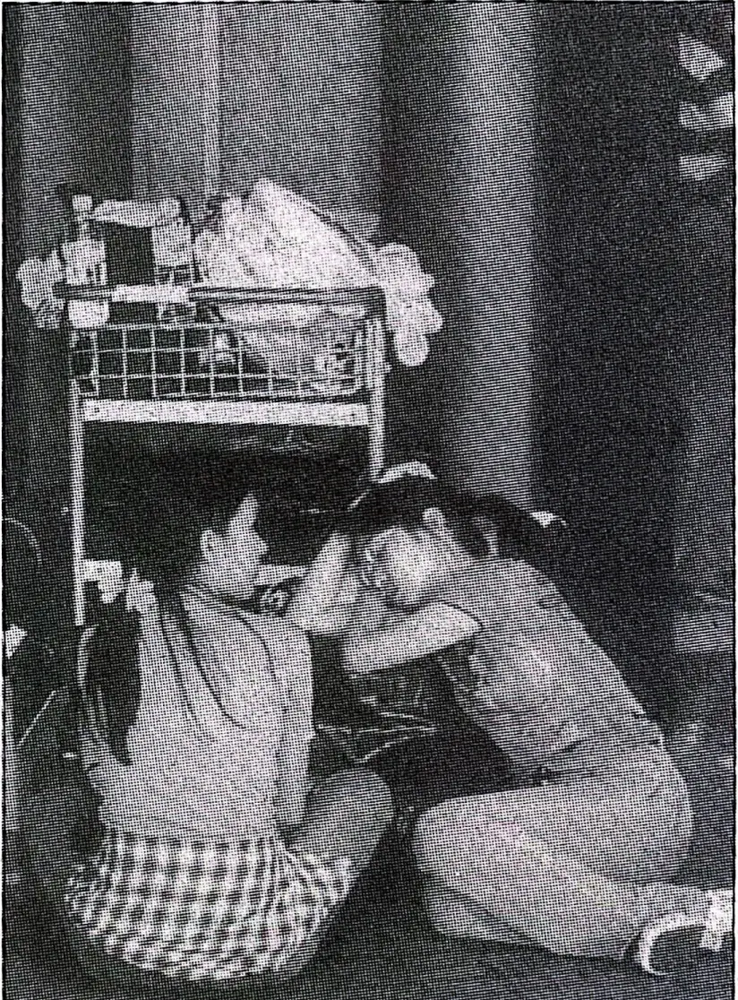

Beberapa lelaki masuk ke dalam rumah orang tua tadi, dan mengobrakabrik semua yang ada di dalamnya. Mereka memukul lelaki tersebut hingga tak berdaya. Setelah itu kaki dan tangannya diikat. Beberapa orang di antara rombongan itu meringkus anak gadisnya. Lalu pakaiannya dilucuti secara paksa. Secara bergantian pula, orang-orang tak dikenal tersebut memperkosa gadis tak berdaya itu.

Semua peristiwa tragis itu terjadi di depan mata sang ayah. Lelaki tua itu hanya bisa memohon dan menangis. Berkali-kali ia menawarkan sejumlah uang kalau orang-orang itu mau pergi. Tetapi, tawaran itu kadang dibalas dengan tendangan. Dan itu dilakukan oleh orang-orang tersebut hingga si ayah lemah lunglai.

Istri dan kedua anaknya yang disuruh bersembunyi di lantai dua, tidak diketahui lagi nasibnya. Entah siapa yang menolong.

Keesokan harinya, ketika sadar, lelaki itu mendapati dirinya telah berada di rumah sakit. Istri dan kedua anak lainnya juga selamat, kendati mereka harus dirawat di rumah sakit pula.

Adapun anak gadisnya yang secara beramai-ramai diperkosa itu, dirawat di salah satu rumah sakit di kawasan Jakarta Pusat. Hingga kini mental sang ayah belum pulih benar.

Cerita di atas hanyalah sepenggal kisah nyata dari derita panjang yang mengharu-biru dan mencabik-cabik harga diri sejumlah keluarga etnik Tionghoa. Masih banyak kisah lain yang tak kalah memilukan.

Dapat dipastikan, pemerkosaan demi pemerkosaan yang dilakukan dengan sadis dan tanpa perikemanusiaan itu, berdampak sangat dalam. Para korban ada yang bunuh diri karena tak kuasa menanggung aib, sebagian lagi hilang ingatan dan terpaksa menjadi penghuni rumah sakit jiwa.

Seorang psikolog senior yang enggan disebut namanya mengatakan, korban yang kehilangan harta benda saja akibat kerusuhan Mei silam dapat dihinggapi trauma, "Apalagi mereka yang mengalami pemerkosaan. Traumanya tentu lebih hebat," ia menandaskan.

Dan, "Trauma itu bukan hanya diderita korban, tapi juga keluarganya. Bahkan orang-orang yang kebetulan menyaksikan, meski tak kenal korban, bisa mengalami trauma pula. Kalau tidak dihinggapi trauma, mungkin orang itu sudah kehilangan rasa kemanusiaannya," psikolog yang juga pendidik ini menambahkan.

Memang, trauma bukan saja menghantui para korban dan keluarganya, tapi juga pada orang-orang yang menyaksikan peristiwa perkosaan itu secara langsung.

Seorang saksi mata yang menolong dua perempuan yang diperkosa di tengah jalan kawasan Cengkareng, mengaku masih saja teringat peristiwa sadis tersebut.

"Semenjak menyaksikan kejadian itu, hidup saya sangat gelisah dan terganggu. Ketika mata saya terpejam, bayangan mayat-mayat wanita itu nampak di depan mata. Saya merasa sangat tertekan. Karena saya tidak kuat menghadapi perasaan cemas dan takut, saya putuskan untuk pulang kampung," tuturnya.

Lain lagi cerita yang diungkapkan seorang kakak, yang adik perempuannya menyaksikan langsung kejadian mengenaskan itu. "Setelah tanpa sengaja melihat seorang gadis Tionghoa diperkosa beramai-ramai, adik perempuan saya begitu ketakutan dan tertekan. Bicaranya ngacau dan badannya bergetar setiap kali ada yang menghampirinya. Dua minggu ia dirawat di rumah sakit. Saya jadi sangsi, adik saya itu hanya menyaksikan orang diperkosa atau dia sendiri juga diperkosa? Kok, reaksinya seperti itu?"

Memang, nurani siapa yang tak terusik dalam, apabila menyaksikan peristiwa sadis seperti itu? Tampaknya, butuh waktu panjang untuk membuat trauma itu perlahan hilang dari ingatan.

"Saya kira itu sangat individual sifatnya. Ada yang bisa cepat mengatasi masalah, punya harapan ke masa depan, ada pula yang lama. Tergantung pribadi orang itu, serta keterampilan konselornya untuk mengubah pemikiran-pemikiran korban yang negatif hingga netral kembali," kata Prof. Dr. Singgih D. Gunarsa.

Memang, secara teoritis, trauma akibat mengalami atau menyaksikan pemerkosaan dapat disembuhkan. Tapi, yang jelas, membutuhkan waktu lama. Sebab, "Ini kan merupakan trauma, dan sesuatu yang berhubungan dengan harga diri serta milik pribadi yang sangat berharga. Sehingga terjadi kegoncangan yang luar biasa," ujar Singgih pula.

Trauma dapat terjadi dalam dua tahap, yaitu dampak jangka pendek dan jangka panjang. Dalam jangka pendek, selain mengalami luka fisik, korban juga mengalami gejolak emosi, yang tidak selalu ditampilkan dalam bentuk tangisan atau histeria. Reaksi yang dominan biasanya adalah ketakutan yang akut.

Ada pula rasa dipermalukan, rasa bersalah, dan perasaan tidak berdaya. Dari segi fisik, korban mungkin kehilangan nafsu makan, sulit tidur, sering mimpi buruk, mual, pusing, serta pegal-pegal di sekujur tubuhnya.

Sedangkan dalam jangka panjang, kenangan-kenangan buruk di masa lalu itu dapat kembali setiap saat dan mengakibatkan depresi atau ketakutan. Kehidupan seksualnya juga bisa sangat berubah akibat kecemasan, perasaan bersalah, serta hilangnya kepercayaan diri yang berkepanjangan.

Oleh karena itu, tidaklah mudah untuk mendorong korban agar memberikan pengakuan atau menceritakan kembali pengalamannya. Lebih jauh lagi, sebagai salah satu mekanisme pertahanan diri, sejumlah korban tidak mau lagi berbahasa Indonesia. "Dengan cara itu, mereka berusaha menghilangkan trauma masa lalunya," tutur Ita Fatia Nadia dari Tim Relawan.

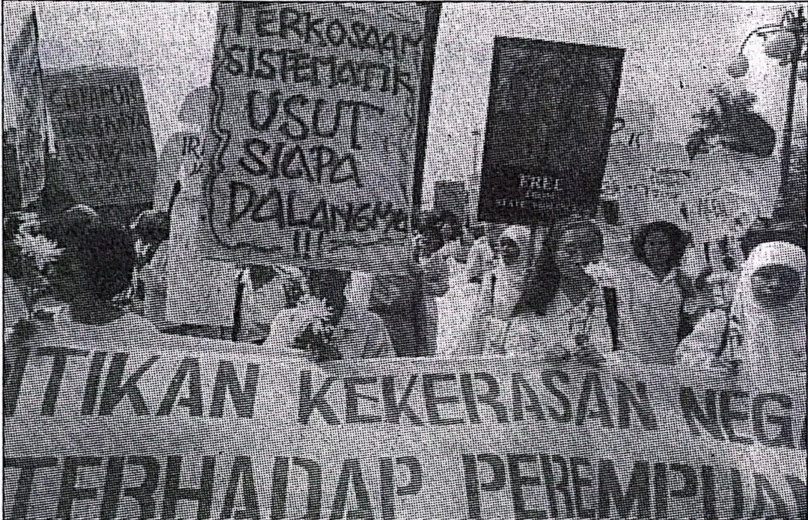

Untuk menceritakan kembali peristiwa pahit tersebut, memang dibutuhkan keberanian luar biasa. Sebagian besar korban enggan mengungkapkannya. Rasa malu dan trauma, membuat mereka sukar percaya kepada siapa pun.

Akibatnya, proses pembuktian terjadinya pemerkosaan massal pun tentu menjadi sulit, kalau tidak mustahil, untuk dilakukan. Mendesak atau memaksa korban untuk memberikan pengakuan dalam rangka pembuktian, bisa jadi menjadi sebuah langkah yang tidak bijaksana dan kontra-produktif, terutama dalam upaya untuk membantu memulihkan kondisi fisik dan psikologis korban.

Selain itu, teror juga mengancam jika mereka berani buka mulut. Bahkan para petugas rumah sakit, dokter, serta para relawan yang membantu mengurangi derita mereka, juga menerima teror dan ancaman.

Sekalipun pengakuan dapat sangat membantu korban untuk memulihkan diri, pengakuan tentu harus dilakukan dengan sangat hati-hati dan bukannya tanpa kelemahan. Sebab, pengakuan dapat membuat korban kembali tenggelam dalam pengalaman buruk masa lalunya. Atau, dengan kata lain, trauma yang terjadi atas dirinya seolah-olah terulang kembali.

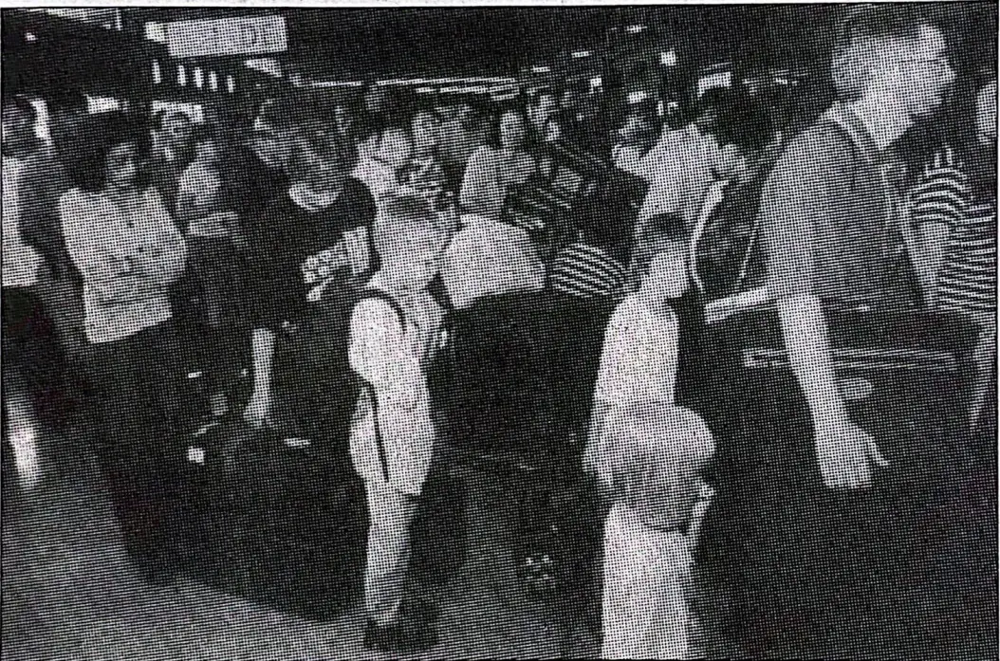

Peristiwa penjarahan, perusakan, dan pemerkosaan yang terjadi pertengahan Mei silam, memang berdampak luas dan mendalam. Menurut sebuah harian asing, kini banyak perempuan etnik Tionghoa di Indonesia yang mencari pasangan hidup dari luar negeri, sehingga dapat cepat-cepat angkat kaki dari Indonesia. Alangkah tragisnya.

Namun, yang patut dicermati pula, dampak negatif dalam keseharian. Tim Relawan mensinyalir, telah terjadinya kerusakan total hidup bersama, mengiringi tragedi 13-14 Mei lalu.

"Beberapa hari sesudah kerusuhan, saya pulang ke rumah naik bajaj. Biasanya saya membayar Rp 3.000. Waktu itu, sopir memaksa saya membayar Rp 10.000. Ketika saya menawar, sopir itu malah mengancam saya. "Mau lu gue perkosa dulu!" tutur seorang saksi korban.

Perilaku kolektif yang mirip dengan perilaku kelompok sebelum dan saat pemerkosaan massal berlangsung, kini telah menjadi gejala perilaku sekelompok orang.

Misalnya yang terjadi pada 25 Juni lalu. Saat itu, serombongan mahasiswi naik mobil pribadi dari kawasan Hotel Indonesia menuju Plaza Senayan. Dalam rombongan itu, ada seorang perempuan Tionghoa.

Mereka berpapasan dengan sekelompok aparat keamanan. Ada beberapa dari kelompok itu yang tersenyum-senyum sambil memberi isyarat seksual khusus tertuju kepada mahasiswi Tionghoa itu. (Laporan saksi mata Tim Relawan, Juni 1998).

Kalau kehidupan bermasyarakat sudah demikian teracuni perilaku biadab para pemerkosa massal Mei lalu, bagaimana kelak nasib bangsa ini? Renungkanlah.

<em>dari berbagai sumber</em>

---

# Buktikan Kalau Kejadian ini Bohong

<strong>Ita F. Nadia, Koordinator Tim Relawan untuk Kemanusiaan Divisi Kekerasan terhadap Perempuan</strong>

**SUDAH TIGA BULAN BERLALU SEJAK KERUSUHAN 13-14 Mei. Bagaimana perkembangan masalah pemerkosaan massa?**

Tim Relawan telah membuat Dokumentasi Awal No. 3, yang berisi laporan pemerkosaan massal dalam rentetan kerusuhan itu. Pada tanggal 13 Juli lalu, kami menyerahkannya kepada Komnas HAM.

Namun, persoalannya sekarang, kasus pemerkosaan masih tetap berlangsung dengan cara teror. Pengkondisian pemerkosaan Mei silam, membuat orang kemudian berpikir, bahwa para perempuan Tionghoa berhak untuk diperkosa atau diteror. Di Bandung keadaan ini berjalan terus. Tanggal satu kemarin saja, di Jakarta Barat, masih terjadi percobaan pemerkosaan.

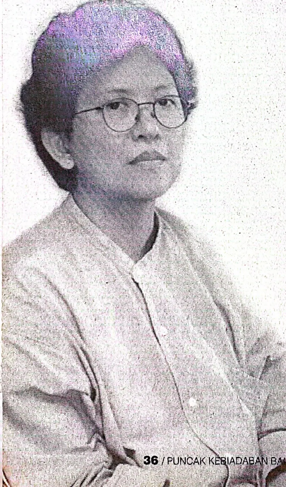

**Apakah karena para pelaku masih berkeliaran, atau orang mengimitasi tindakan brutal Mei itu?**

Para pemerkosanya tidak diketahui, apakah orang yang sama seperti Mei lalu. Tapi, ada semacam pengkondisian, pemerkosaan ini dibenarkan atau dihalalkan untuk para perempuan etnik Tionghoa.

**Ataukah karena belum ada tindakan tegas terhadap kasus-kasus pemerkosaan massal pada Mei lalu?**

Ya. Belum ada satu tindakan yang menyatakan masalah ini harus dibongkar tuntas, meskipun Presiden Habibie sudah mengatakan, mengutuk tindakan kekerasan terhadap perempuan.

Ada sedikit harapan, bahwa pemerintah membentuk Tim Pencari Fakta Gabungan (TPFG). Itu kami anggap sebagai suatu usaha pemerintah menganggap serius masalah ini.

**Apakah Tim Relawan menjalin kerja sama dengan Menperta?**

Secara langsung tidak ada. Tapi, jika Menperta menggunakan data yang kami berikan, itu perkara lain.

**Dengan kepolisian?**

Itu juga tidak ada secara langsung. Pihak kepolisian pernah datang kemari, dan mengajak bekerja sama. Tapi sampai saat ini belum terealisi.

**Adakah pelaku yang sudah ditangkap atau mengaku?**

Sejauh ini belum. Tapi, yang penting bukan menangkap para pelakunya. Peristiwa pemerkosaan massal itu kan sudah beberapa bulan berlalu. Persoalannya sekarang, peristiwa ini sungguh terjadi, dan perlu diusut siapa di balik semua ini? Sebab, peristiwa pemerkosaan massal tidak bisa dilepaskan secara sendiri dari seluruh peristiwa kerusuhan Mei silam.

**Adakah kesamaan para pelaku kerusuhan dengan pemerkosaan massal?**

Ya. Yang melakukan penyerangan, pemerkosaan, dan pembakaran adalah orang-orang yang sama. Tapi, yang melakukan penjarahan berbeda. Mereka hanya ikut-ikutan karena diajak.

**Bagaimana dengan para pelaku penculikan aktivis-aktivis. Adakah kesamaannya?**

Wah, itu masih harus dibuktikan secara hukum. Ini merupakan suatu paket teror yang terus berlanjut. Saya tidak tahu. Ini tugas dari TPFG untuk mencari tahu, apakah ada satu benang merah antara penculikan para aktivis dengan kerusuhan dan pemerkosaan massal.

**Jadi, siapa yang harus bertanggung jawab terhadap amuk massa itu?**

Wah, saya tidak tahu. Biarlah itu dibuktikan oleh TPFG.

**Seberapa besar harapan terhadap TPFG?**

Itu merupakan tugas, dan harus menjadi pertanggungjawaban pemerintah, kalau memang pemerintah benar-benar mau membongkar masalah kerusuhan dan pemerkosaan massal ini secara tuntas.

**Ada tulisan di media cetak yang meragukan kebenaran terjadinya pemerkosaan massal Mei lalu....**

Kalau saya, saya kembalikan lagi pernyataan itu kepada pemerintah. Presiden dan Menperta sudah mengutuk tindakan tersebut, berarti pemerintah sudah mengakui, bahwa hal itu memang sungguh terjadi.

Masalahnya, ada tuntutan di sini untuk menunjukkan korban. Padahal, korban pemerkosaan itu kan mengalami trauma yang luar biasa. Apalagi ini korban pemerkosaan massal. Korban merasa dalam keadaan tidak aman. Ia diteror, begitu juga keluarga dan komunitasnya. Jadi, menunjukkan korban pemerkosaan ke hadapan publik, sama juga dengan memerkosa korban itu kembali.

Kalau ada orang mengatakan kejadian itu bohong, tolong tunjukkan fakta bahwa kejadian itu memang tidak benar dan bohong. Jangan cuma asal ngomong. Sebab, kami bicara berdasarkan fakta juga, bukan hanya omongan.

**Selain ke Komnas HAM, kepada siapa lagi Tim Relawan memberikan laporan tentang kekerasan terhadap perempuan itu?**

Kami hanya memberikannya ke Komnas HAM. Sebab, kami menganggap, kami supporting system dari Komnas HAM. Dengan menyerahkannya ke Komnas HAM, berarti dokumen itu bisa dipakai oleh siapa pun.

**Anda mengundurkan diri dari TPFG. Siapa yang menggantikan?**

Tidak ada yang menggantikan. Mereka mendesak saya untuk kembali. Alasan saya mengundurkan diri, karena di sana sudah ada Romo Sandyawan, Sekretaris I Tim Relawan untuk Kemanusiaan. Mereka tidak mau mencoret nama saya sampai sekarang. Saya sendiri belum memberi keputusan.

Tapi, saya akan duduk di Komisi Nasional Aksi Kekerasan terhadap Perempuan, semacam Komnas HAM-nya perempuan. Komisi ini akan diketuai oleh Ibu Saparinah Sadli, dan diresmikan dalam waktu dekat berdasarkan Surat Keputusan Presiden.

**Apakah nanti tidak tumpang tindih dengan TPFG?**

Komisi Nasional HAM perempuan akan memberi masukan pada TPFG. Area kerja kami juga beda. TPFG kan hanya tiga bulan. Kalau di komisi sifatnya jangka panjang, dan berfokus pada penelitian, pendidikan, dan perubahan kebijakan. 

<em>Wawancara langsung Tim Pemburu Fakta, tgl 6/8/98</em>

---

# Pemerkosaan Massal Bukan Tabiat Orang Indonesia

<strong>Dr. Rosita Noer, Ketua Umum Badan Komunikasi Penghayatan Kesatuan Bangsa (Bakom PKB) Pusat</strong>

"BANYAK SAKSI MATA YANG MENYAKSIKAN PEMERKOSAAN dan pelecehan seksual," kata Rosita Noer, Ketua Umum Bakom PKB Pusat. Rosita yang juga pemilik perusahaan Noer Associates, yang berkiprah di bidang ekspor minyak kelapa dan konsultan public relation ini, beberapa waktu lalu bertemu dengan Komisi II DPR. Bakom PKB mendesak pemerintah untuk membentuk komisi pencari fakta yang independen untuk kerusuhan Mei itu.

Lahir 28 September 1947 sebagai anak tunggal dari Baginda Sofyan Noer dan Raden Ayu Rosma Wigati, Rosita Noer kerap berbicara tegas, vokal, dan penuh kritik.

Dokter lulusan Fakultas Kedokteran Universitas Indonesia ini mengaku shock, karena ternyata dalam kerusuhan 13-14 Mei itu, diikuti dengan pelecehan seksual dan pemerkosaan terhadap warga Indonesia keturunan Tionghoa.

Berikut, petikan wawancara reporter MATRA dengan Rosita Noer:

## Menurut Anda, apa yang menjadi penyebab kerusuhan 13-14 Mei?

Kerusuhan 13 -14 Mei, pertama bisa dianggap karena terjadinya krisis ekonomi yang berkepanjangan. Ini merupakan tekanan ekonomi yang membuat mereka mencari sasaran. Anggapan kedua; bisa jadi pelampiasan politis. Selama 30 tahun, bangsa kita tidak pernah diajar bicara dengan baik. Ada suatu budaya politik yang membuat orang bungkam. Dipolitisasi. Akibatnya, orang tidak bisa bicara lagi secara santun, tidak mempunyai rasa percaya diri untuk mengatakan secara baik sebagai warga negara.

Kemudian, timbullah kelompok-kelompok yang mudah dipicu dan dibayar. Sebab, memperkosa orang beramai-ramai, tampaknya itu bukan tabiat orang Indonesia. Ada rasa malu yang luar biasa. Mungkin para pelakunya adalah orang-orang terorganisasi, yang pekerjaannya tidak dihargai oleh masyarakat, atau barangkali manusia yang mempunyai kadar kebinatangan yang tinggi.

## Lalu, mengapa yang menjadi sasaran kerusuhan dan pemerkosaan itu warga Indonesia keturunan Tionghoa?

Sasaran yang secara fisik dan politis dianggap empuk adalah warga keturunan Tionghoa. Sebab, secara ekonomi etnik Tionghoa Indonesia dianggap berkolusi dengan penguasa dan menguasai perekonomian.

## Apa benar tindakan kerusuhan dan pemerkosaan itu adalah tindakan spontan dari oknum masyarakat?

Berdasarkan data yang dikumpulkan Bakom PKB, kejadian itu dibuat secara terorganisir dan sistematis. Tidak mungkin spontan dan sporadis. Organisasi kriminal itu terencana, bertahap. Sebab, waktunya hampir bersamaan. Terlalu profesional bila dikatakan spontan. Misalnya, datang ke suatu perumahan, menjarah terlebih dahulu, memperkosa paling tidak mempermalukan, mengusir penghuni dari rumah, kemudian membakarnya.

Berdasarkan saksi mata, kedatangan segerombolan orang ke sebuah apartemen, di mana setiap lantai diserbu puluhan orang, tidak mungkin terjadi, jika tidak diorganisir.

## Berapa data korban pemerkosaan yang Anda dapati?

Berdasarkan pemantauan Bakom PKB, secara garis besar untuk sementara ada 468 perempuan. Usia mereka berkisar 10-55 tahun. Tapi, ada satu anak berusia 3 tahun yang diperkosa di depan mata ayahnya sendiri. Pengumpulan data tersebut didapat dari tiga sumber. Pertama korban sendiri, saudara korban, dan saksi mata.

Dari jumlah sebesar itu sekitar 60 wanita diperkosa kemudian dibuang ke kobaran api. Semua data didapat dari wilayah Jabotabek. Didapatkan fakta pula, biasanya seorang wanita diperkosa oleh minimal 5 orang.

## Akibat kerusuhan, masih banyak warga keturunan Tionghoa yang enggan kembali ke dunia usaha. Mengapa?

Orang sekarang hidup dibayang-bayangi ketakutan. Selama rasa ketakutan mencengkeram, belum ada yang berlangsung normal. Warga etnik Tionghoa, suka atau tidak suka harus diakui, memegang peranan yang cukup penting dalam perdagangan. Kalau mereka tidak merasa tidak aman dan nyaman, mereka yang memiliki uang, bisa pergi keluar negeri. Mereka tidak akan membangun usaha lagi, bila tidak ada ketenangan. Budaya perdagangan membutuhkan sifat keuletan, hemat, dan kepercayaan. Sifat-sifat ini yang saya lihat terdapat pada warga keturunan Tionghoa.

Di Indonesia, etnik Tionghoa merupakan minoritas yang menarik. Untuk bersatu, orang mengatakan it *takes two to do tango*. Tidak mungkin hanya satu pihak yang mengulurkan tangannya. Jadi dengan pelajaran yang sangat mahal ini, diharapkan dari kalangan mayoritas mau melihat secara jernih, jika kalangan minoritas ini memegang peranan yang dibutuhkan.

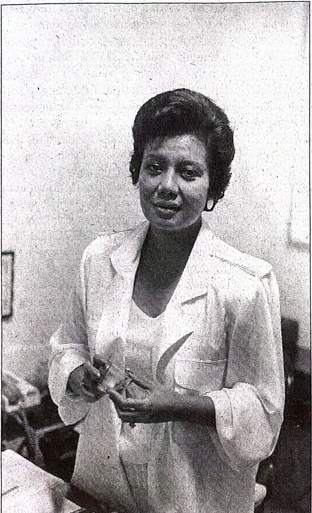

## Lalu, bagaimana menurut Anda mengenai pembauran di Indonesia?

Dalam Undang-Undang Dasar 1945, Pasal 27 dikatakan, setiap warganegara bersamaan kedudukannya dalam hukum. Tetapi pada kenyataannya, warga keturunan Tionghoa dalam pembuatan Kartu Tanda Penduduk (KTP) memerlukan surat keterangan yang disebut K1.

Ini menunjukkan, jikalau mereka dibedakan. Kegagalan pembauran ini bisa dilihat dari adanya Surat Bukti Kewarganegaraan RI yang harus dimiliki setiap warga keturunan Tionghoa, dan menjadi makanan empuk bagi administrator.

---

# Apa Kata Mereka?

AMUK MASSA BERBAU RASIAL YANG meletus pada 13-14 Mei lalu di Jakarta dan beberapa kota besar lain di Indonesia, mengundang komentar berbagai kalangan.

Berikut, petikan beberapa di antaranya:

## Romo Sandyawan Sumardi, Sekretaris I Tim Relawan untuk Kemanusiaan

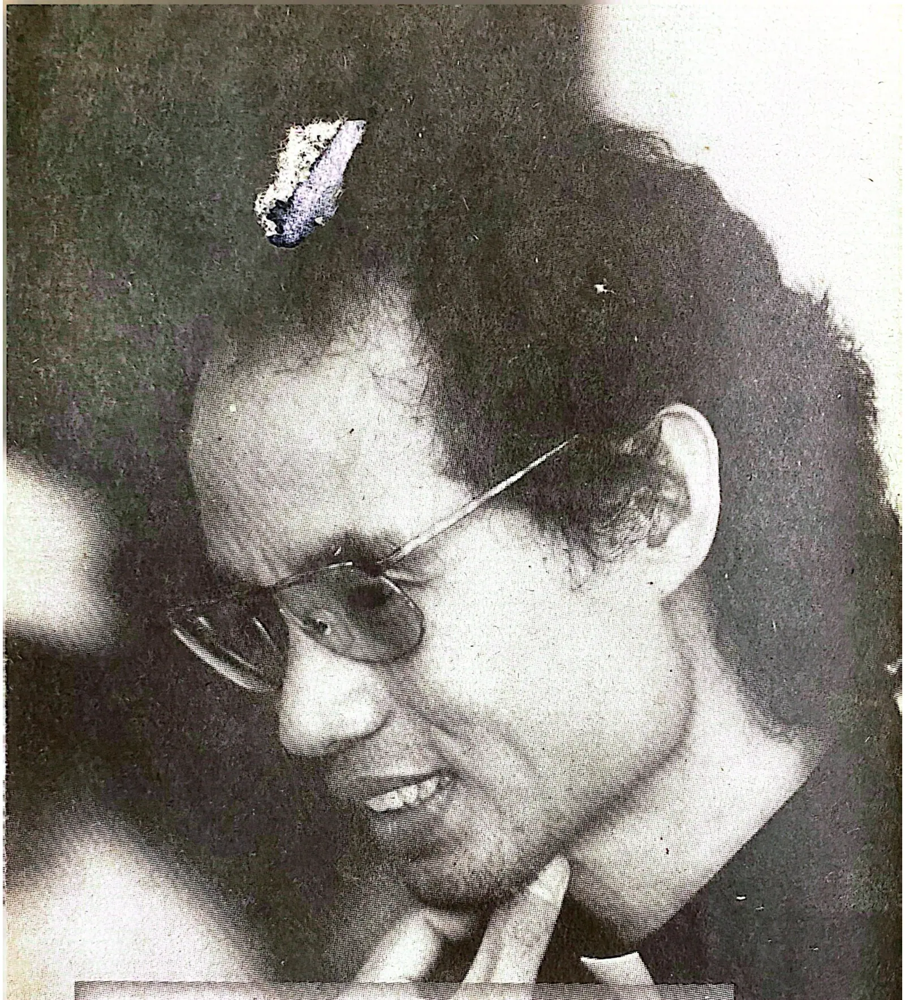{.image-medium}

Ini merupakan sebuah pornografi politik yang paling mengerikan. Korbannya begitu masif, sangat dramatis dari segi cara, metode, dan dari segi ketidakpedulian pada kondisi psikologis korban.

Pada waktu itu, ada 970 mayat di Rumah Sakit Cipto Mangunkusumo. Kami masuk ke sana, langsung pusing. Bukan karena bau, tapi kenangan betapa berdarahnya rezim ini. Itulah yang membuat kami pusing betul.

## Nursyahbani Katjasungkana, S.H., Direktur Lembaga Bantuan Hukum -Asosiasi Perempuan Indonesia untuk Keadilan (LBH-APIK)

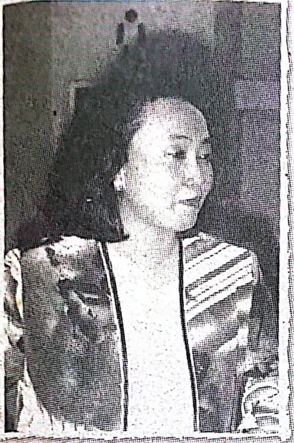{.image-medium}

Ini sebuah strategi untuk tetap mengherokan ABRI. Setelah peristiwa penembakan mahasiswa Trisakti, ABRI terpojok betul. Di sini militer perlu keluar dari keterpojokan itu dengan penciptaan.

Ke mana ABRI ketika kerusuhan terjadi? Baru setelahnya, beberapa perwira ABRI membuat statement di media massa, bahwa keadaan sudah terkendali. Ini sudah terdesain dengan kuat, dan merupakan strategi ampuh sejak 1965.

## Onghokham, Sejarawan

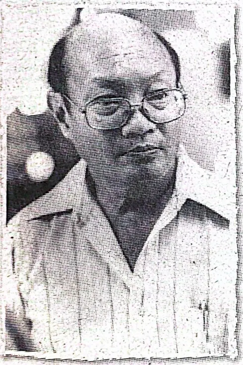{.image-medium}

Boleh dikata, ini kerusuhan besar pertama yang terjadi di Jakarta. Mungkin bukan yang terbesar skalanya dalam sejarah Republik, tapi cukup mengejutkan. Sebab, peristiwanya meletus di Ibu Kota. Berarti, aparat keamanan tidak bisa mengamankan Jakarta. Kalau Ibu Kota saja gagal diamankan, tak ada sesuatu lagi yang aman.

## Hendardi, Direktur Eksekutif Perhimpunan Bantuan Hukum dan Hak Asasi Manusia

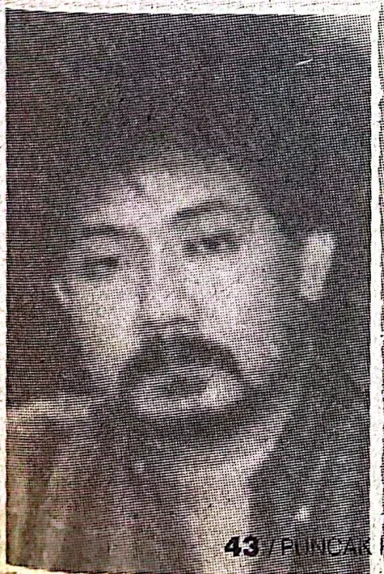{.image-medium}

Peristiwa kerusuhan menghancurkan mitos perlindungan keamanan masyarakat yang selama ini dijamin ABRI lewat pernyataan-pernyataan bahwa stabilitas aman dan terkendali.

Karena itu, pengusutan dan pengungkapan peristiwa kerusuhan Mei lalu, yang diduga digerakkan oleh kelompok terorganisir, mutlak dilakukan. Termasuk, menjawab pertanyaan masyarakat mengenai di mana keberadaan aparat keamanan pada waktu kerusuhan terjadi.

Kalau kedua masalah itu tidak terjawab tuntas, rasa aman pengusaha dan investor asing maupun warga keturunan Tionghoa yang meninggalkan Indonesia akibat kerusuhan, tidak akan pulih.

## Kwik Kian Gie, Ekonom

Tugas pemimpin di mana pun adalah membina perasaan dan emosi saling mengasihi di antara warga negaranya, serta meredam emosi hewani yang destruktif terhadap satu sama lain.

Di mana saja ada ketimpangan sosial, akan menimbulkan kecemburuan dan kerusuhan sosial. Warga keturunan pun sebenarnya muak terhadap sekelompok kecil konglomerat yang hanya bermodalkan kolusi dengan kekuasaan.

Memang, rekayasa politik pada kerusuhan Mei lalu itu ada dan lihai. Sangat canggih, sehingga lebih menang dari aparat keamanan. Kerusuhan rasial sebenarnya sudah pernah terjadi. Tapi, kali ini sangat mengejutkan. Yang paling menyedihkan, ada oknum-oknum tertentu yang mengorganisir kekejian yang mencoreng muka Indonesia di mata internasional.

Tentang pemerkosaan massal, ada indikasi yang melakukannya adalah orang-orang yang tidak dikenal para tetangga. Secara psikologis, orang sulit melakukan pemerkosaan, jika tidak sakit jiwa. Untuk bisa mengumpulkan orang yang sakit jiwa begitu banyak pada saat dan tempat yang sama, kan perlu organisasi.

## Nurcholis Madjid, Cendekiawan Muslim dan Ketua Yayasan Paramadina

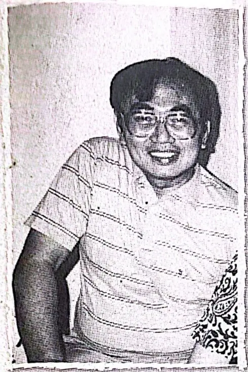{.image-medium}

Untuk mencegah terjadinya kembali kerusuhan massa, harus ada kemauan politik dari para pemimpin yang otentik secara etis dan moral. Selain itu, harus ada keterbukaan dan kejujuran dalam penyelenggaraan pemerintahan dan kekuasaan. Faktor itu juga merupakan kunci penting penyelesaian masalah pribumi dan nonpribumi.

## Rudy Hartono, Pemain Bulu Tangkis, Juara All England 8 Kali

{.image-medium}

Saya paling tidak setuju adanya pengkotak-kotakan dalam masyarakat. Contoh gamblang adalah soal pembuatan Kartu Tanda Penduduk (KTP). Jelas tertera adanya pembedaan antara saya dengan warga negara lainnya. Ini saya rasa tidak benar.

Soal istilah pri dan nonpri, sudah saatnya tidak lagi dikedepankan. Bagi warga keturunan Tionghoa, saya menganjurkan, agar tidak lagi bersikap eksklusif di tengah masyarakat umum, meski sebenarnya saat ini sudah mulai banyak juga warga Tionghoa yang tidak berlaku demikian.

## Amien Rais, Ketua Pimpinan Pusat Muhammadiyah

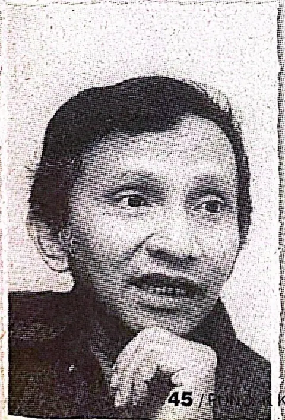{.image-medium}

Di kota kelahiran saya, Solo, antara warga keturunan dan warga pribumi senantiasa mesra, dan nyaris tak ada jarak. Karena itu, saya tidak rela bila rumah dan toko warga keturunan etnik Tionghoa dibakari. Etnik Tionghoa adalah bagian integral dari bangsa Indonesia.

## Harry Tjan Silalahi, Peneliti Senior CSIS

Di Indonesia, kalau terjadi masalah kerusuhan berbau SARA (Suku, Agama, Ras, dan Antargolongan), dan kemudian meluas, biasanya tidak spontan. Setidaknya, ada yang mengarahkan.

Selain itu, jauh sebelumnya sudah diciptakan suasana sedemikian rupa yang menjurus ke SARA. Ini sebagai akibat suatu situasi, biasanya sosial, ekonomi, atau politik, yang lekat dengan masyarakat.

Untuk itu, pembauran harus didukung oleh pengembangan dan peningkatan faktor integratif bangsa, dan menghindari faktor disintegratif. Saya berharap, dapat terbentuk usaha mencari sosok kebangsaan Indonesia yang sejati, supaya Indonesia menjadi satu kesatuan.

## Sofyan Wanandi, Pengusaha

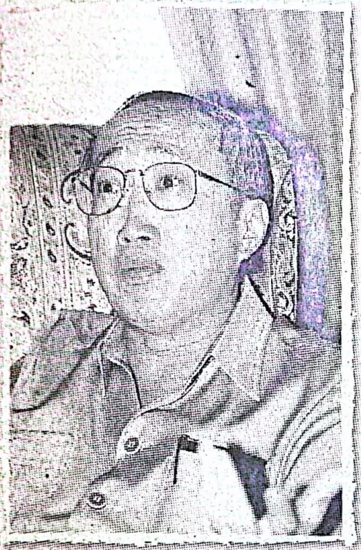{.image-medium}

Saya perkirakan, jumlah warga keturunan Tionghoa yang pergi ke luar negeri akibat kerusuhan kemarin, jumlahnya antara 10.000-30.000 orang. Tidak sampai 100.000. Kalau hanya 30.000 orang yang pergi, itu kan sangat kecil jika dibandingkan dengan 5 juta warga keturunan Tionghoa di Indonesia.

Yang pergi, bukan yang besar-besar. Sebab, yang besar-besar itu sejak lama sudah menanam bisnisnya dan sudah menjadi global. Yang lari itu yang menengah dan kalangan profesional yang bisa kerja di mana saja, karena pendidikannya tinggi, pintar, dan tidak punya perusahaan.

Saya mengerti, mereka sangat trauma akibat adanya ancaman yang mengganggu keselamatan fisik mereka. Jadi, tidak bisa dipersalahkan kalau mereka tidak atau belum mau pulang.

## Ester Indahjani Jusuf S.H., Ketua Komite Pemuda Indonesia untuk Penghapusan Diskriminasi Ras (Solidaritas Nusa Bangsa)

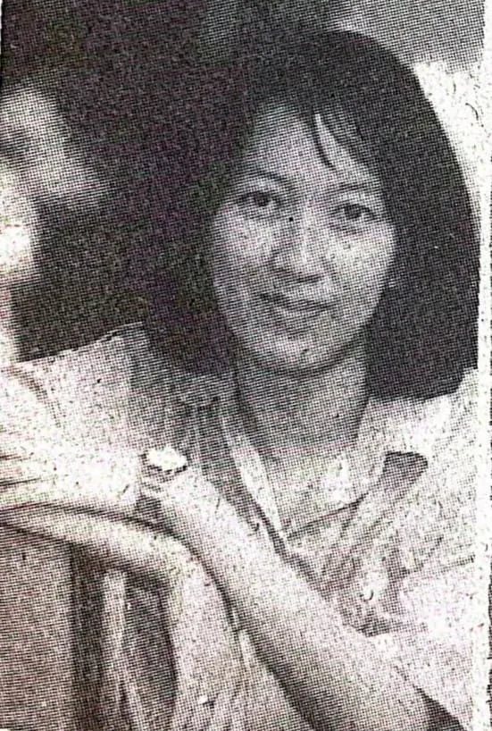{.image-medium}

Ada kebijakan-kebijakan politik tertentu dari rezim Orde Baru yang mengakibatkan terjadinya kerusuhan ini, Memang, di masa itu ada segelintir orang Tionghoa yang mendapat kemudahan dari aparat dalam menjalankan roda perekonomian. Ini

menimbulkan kecemburuan sosial yang besar.

Tapi, kita tidak bisa menyalahkan orang Tionghoa semata. Sebab, siapa sebetulnya yang mula-mula memberikan fasilitas itu? Lagipula, bukan hanya etnik Tionghoa yang mendapatkan kemudahan tersebut. Mengapa pemerintah membiarkan sentimen tertentu tumbuh?

Sebetulnya, jika sampai terjadi sentimen terhadap ras tertentu dalam suatu negara, sudah menjadi tugas negara untuk menanamkan rasa persatuan bangsa kepada masyarakatnya. Namun, kalau selama 32 tahun sentimen ini tumbuh, menjadi pertanyaan juga buat kami. Mengapa tidak ada kebijakan khusus untuk mengatasinya?

Soal keeksklusifan orang Tionghoa, saya pikir, semua orang punya eksklusivitas dan adat istiadat tersendiri. Kita tidak bisa semena-mena menyatakan sebuah kelompok eksklusif. Lihat saja, kan ada kampung Jawa, kampung Ambon.

## Arief Budiman, Sosiolog, kini Kepala Program Kajian Indonesia di University of Melbourne

Orang Tionghoa yang lahir di Indonesia, bukan generasi pertama, pada dasarnya orang Indonesia, bukan Tionghoa. Mereka warga negara Indonesia keturunan Tionghoa yang sudah tidak bisa berbahasa Mandarin

Kalau pergi sebulan saja dari negeri ini, sudah tidak betah. Kerinduannya pada pecel dan tempe besar sekali. Saya, misalnya, delapan tahun berada di Amerika Serikat. Sesudah selesai studi, ada yang menawari pekerjaan. Tapi saya tolak. Saya mau ke Indonesia saja, karena capek ngomong Inggris terus. Sampai mimpi pun pakai bahasa Inggris

Saya ingin tekankan juga saya tidak yakin kerusuhan Mei lalu adalah kerusuhan rasial. Buktinya, sesudah kerusuhan terjadi, para relawannya orang pribumi. Dan mereka semua mengakui, itu biadab

Yang terjadi pada 13-14 Mei, membuat kita harus kembali berkaca. Apakah kita masih dalam tahap tribalisme, menurut istilah Nurcholis Madjid, merasa manusia di luar kelompok kita merupakan sub human, manusia yang lebih rendah derajatnya.

Kita harus bangkitkan lagi keyakinan, manusia itu lahir meski bukan bagian kelompok kita—adalah manusia juga. Jangan lalu berkata,“Ah, itu kan orang Cina, diperkosa biarin aja.” Selama berpikir begitu, hal ini akan terjadi lagi Bukan hanya pada orang Tionghoa, tapi bisa kelompok atau orang lain. Ini tribalisme.

## Christianto Wibisono, Direktur Pusat Data Bisnis Indonesia

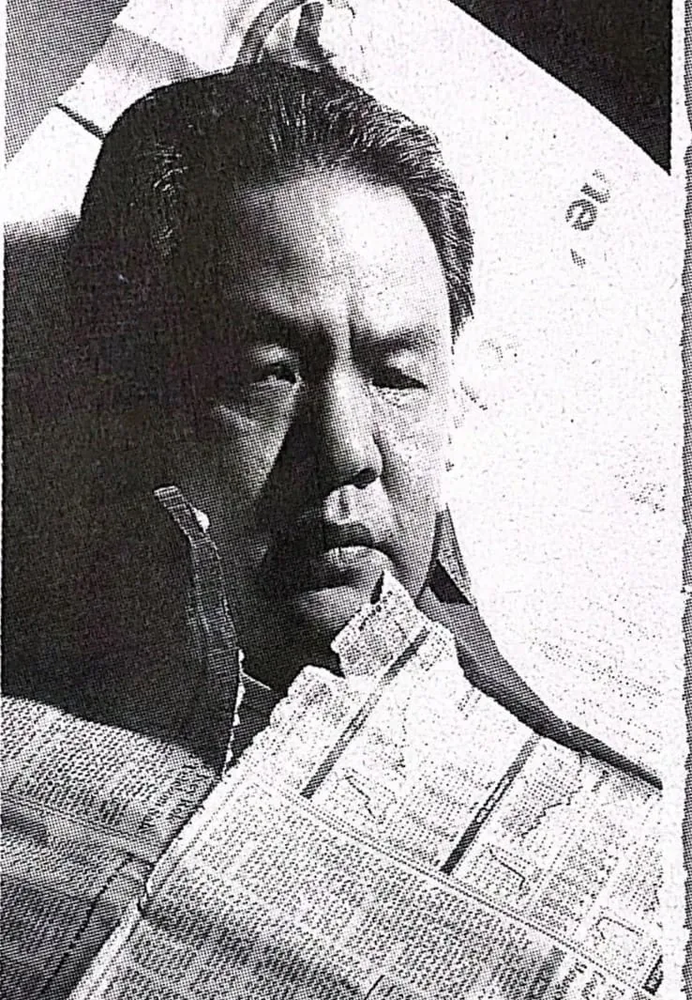{.image-medium}

Saya menangis memikirkan nasib Republik Indonesia berdasar Pancasila yang lahir 17 Agustus 1945. Penembakan mahasiswa pada 12 Mei telah memicu penjarahan dan perusakan yang belum pernah terjadi dalam sejarah Republik. Junus Yahya mengecam aksi itu, karena menunjukkan gejala ethnic cleansing seperti di bekas Yugoslavia.

Massa yang beringas dan brutal telah menjarah dan memusuhi sesama rakyat, yang kebetulan berbeda etnik dan berbeda ekonomi. Namun, aparat keamanan tidak kelihatan batang hidungnya, di saat penjarah merajalela.

Yang dibakar oleh perusuh pada 13 Mei bukan sekadar bangunan fisik atau rumah. Tapi, rasa kemanusiaan yang adil dan beradab, yang sulit dipulihkan seperti mengembalikan bekas jarahan kepada pemilik sah.

Yang dibunuh oleh perusuh bukan sekadar bangkai atau mayat ratusan orang yang terpanggang di pertokoan. Yang sedang dibunuh ialah watak sopan santun, belas kasihan, dan peri kemanusiaan dari Ibu Pertiwi, bangsa, dan negara.

Saya ingin menyerukan untuk berhenti menghembuskan kebencian dan diskriminasi rasial kepada warga keturunan, dengan tuduhan yang tidak objektif, sekadar dilandasi sentimen rasial belaka

Bila ada warga keturunan yang berkolusi, itu tidak berarti seluruh lima juta warga juga berkolusi. Mereka justru menjadi korban pemerasan dan kolusi.

Kita harus menilai orang secara individual, dan bukan secara kelompok etnik. Warga keturunan bukan orang asing yang bisa dievakuasi seperti warga asing. Warga keturunan jelas mempunyai hak hidup di bumi Indonesia.

Warga keturunan juga adalah pendiri negeri ini, yang diwakili dalam Badan Penyelidik Usaha Persiapan Kemerdekaan Indonesia (BPUPKI) oleh Mr. Tan Eng Hoa, Oei Tjong Hauw, Mr. Liem Koen Hian, dan Oei Tiang Tjoei.

Saya ingin menegaskan, warga negara keturunan Cina punya hak hidup, dan akan mempertahankan hak untuk hidup di bumi Indonesia, sebagai umat yang dicipta oleh Tuhan secara bermartabat.

---

# Di Mana Kau, Ibu?

<strong>Menyoal Lambannya Upaya Pemerintah</strong>

DI BALIK KEBISUAN DINDING RUMAH, TAK TERBILANG WNI keturunan Tionghoa yang hingga kini meratapi nasibnya. Entah istri, anak, saudara, atau kerabat mereka menjadi korban. Namun, mereka memilih bungkam, pasrah.

Keengganan mereka melapor ke aparat keamanan boleh jadi didasari pengalaman menyesakkan saat terjadinya kerusuhan. Seperti dialami Rina (bukan nama sebenarnya).

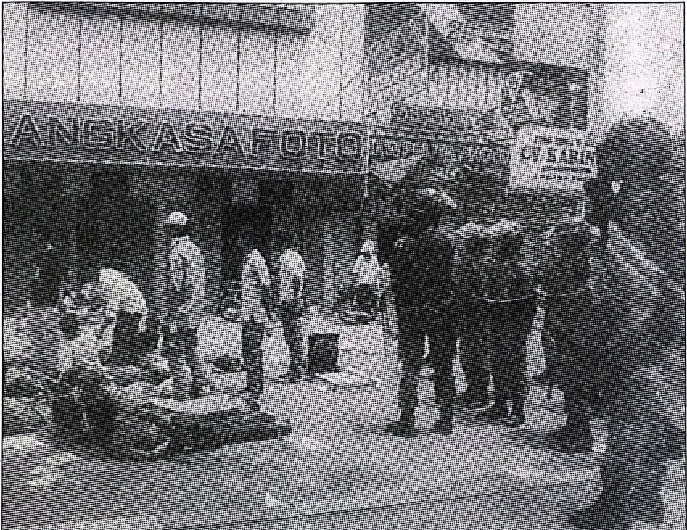

Ketika ruko milik keluarganya di Jakarta Barat diserbu tujuh orang, Rina dan dua adiknya yang kebetulan sedang berada di lantai tiga, dipaksa telanjang. Rina tidak diapa-apakan, karena dianggap sudah berumur. Penderitaannya memuncak, ketika dipaksa menyaksikan kedua adiknya disetubuhi.

Setelah menyalurkan nafsu liarnya, para pemerkosa itu membakar ruko. Jeritan ketakutan, raung kesedihan, amarah, dan permintaan ampun, bercampur dari mulut kakak-beradik itu. Sia-sia. Malahan, kedua gadis yang diperkosa itu didorong ke lantai dasar yang sudah terpanggang api. Keduanya tewas.

Rina tahu, di depan rukonya ada beberapa petugas keamanan. Tapi, mereka diam saja. Bahkan, di deretan rukonya masih ada empat keluarga lain yang mengalami musibah serupa. Itu pun tidak dicegah aparat.

Selain pengalaman yang menimbulkan amarah terhadap aparat keamanan, lantaran membiarkan peristiwa biadab itu terjadi di depan mata, selama ini kebanyakan etnik Tionghoa Indonesia sedapat mungkin menghindari hubungan dengan petugas keamanan.

Sebab, petugas keamanan berarti uang ekstra. Itu pun tidak menjamin, kasus mereka bakal tuntas. Masuk akal, jika kemudian mereka memilih diam seribu bahasa.

Di Solo, sampai pertengahan Juni kemarin, masih ada sejumlah orang yang mendatangi para korban kerusuhan dan mengancam. Katanya, kalau berani membangun rumahnya lagi, maka rumahnya akan dibakar dan anaknya diperkosa.

“Melapor kepada aparat? Buat apa?” kata seorang nyonya yang tempat usahanya sekarang tinggal puing dan abu. Ia merasa sakit hati, karena laporannya tidak ditanggapi sama sekali oleh aparat.

Di samping sikap apatis terhadap petugas keamanan, korban punya alasan lain untuk tidak melapor. “Ada di antara mereka yang mendapat ancaman lewat telepon. Mereka akan dibunuh jika melapor. Karena itu, kami sangat menjaga kerahasiaan para korban,” kata Ita yang juga tak lepas dari ancaman teror.

Maka, tidak heran jika kepada sebuah harian Ibu Kota yang mewawancarainya akhir Juni lalu, Kepala Dinas Penerangan Kepolisian Dinas Metro Jakarta Raya Letnan Kolonel (Polisi) Drs. Edward Aritonang, menyatakan, sejauh ini pihaknya belum menerima laporan tentang penyerangan terhadap perempuan saat kerusuhan terjadi.

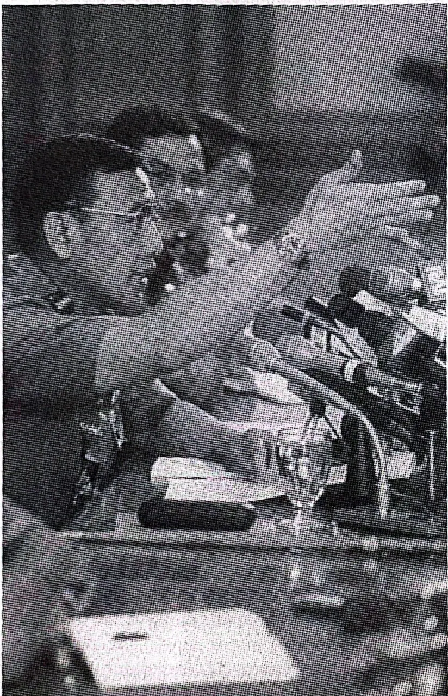

## Baru Sekadar Isu

SESUNGGUHNYA, BENARKAH TERJADI PERISTIWA pemerkosaan dalam kerusuhan di pertengahan Mei lalu?

*Ibu, Pengayom kami\
Para perempuan negara ini Mendamba tanya ....*

*Kala rasa takut tak juga menyurut\
Kala sakit tak tuntas diteriakkan\
Kala amarah tak habis mereka\
kunyah\
Kaum kami itu ambruk terpuruk\
tak berbentuk\
Luka-luka jiwa dan raga parah\
bernanah\
Hangus berarang hati dan perasaan terpanggang di atas puing-puing\
kehancuran\
maka\
bagaimanakah Ibu menyikapinya?*

*Ibu,\
Bila masih tersisa nurani bagi\
kaum kami\
Kami hanya mendamba\
bersabdalah\
Sepatah kata saja\
Maka mereka akan tersapa, sebagai\
manusia*

*Akhirnya,\
wahai Ibu\
kami hanya bertanya sesungguhnya apakah peran\
Menteri Peranan Wanita\
di Negara Pancasila?*

Demikian bunyi salah satu surat pembaca yang dimuat di majalah D & R terbitan awal Juli lalu. Sayangnya, Ibu yang didamba hanya bicara singkat saat ditanya pers akhir Juni silam, “Itu baru sekadar isu.”

Keruan saja sikap acuh tak acuh Hj. Tutty Alawiyah itu membuat LSM-LSM perempuan, dan para simpatisan korban gemas. Tanggapan Ibu Menteri itu didasari fakta, tidak adanya satu pun laporan yang mendarat di mejanya.

## Tidak Ada Korban

TAK HANYA MENTERI URUSAN PERANAN WANITA yang menyangsikan adanya korban kekerasan terhadap perempuan. Senin (29/6) Panglima ABRI, Jenderal Wiranto dalam suatu konperensi pers, antara lain berbicara soal pemerkosaan dalam kerusuhan.

Menurut Pangab, ABRI yang bekerja sama dengan berbagai pihak, telah mendatangi alamat yang diduga menjadi korban pemerkosaan. Tapi sejauh ini mereka mengelak dan menyangkal sebagai korban, bahkan membantah kalau mereka pernah memberikan keterangan kepada pihak tertentu.

Tim ABRI pun telah mengusut 20 rumah yang menampung korban kerusuhan 13-14 Mei. Laporan resmi tim mengatakan, dari 630 korban yang dirawat, 12 meninggal, 87 rawat inap, sisanya bisa pulang hari itu juga. Namun, “Tidak disebutkan adanya korban akibat pemerkosaan,” kata Pangab.

Upaya yang tak kenal lelah dari Tim Relawan, akhirnya membuahkan hasil. Sejumlah korban atau keluarganya mulai melakukan kontak dengan Tim Relawan.

## Investigasi Masih Sulit Dilakukan

TERUNGKAPNYA KASUS KEKERASAN TERHADAP perempuan etnik Tionghoa berawal dari telepon yang diterima Romo Sandyawan. Sekretaris I Tim Relawan untuk Kemanusiaan ini mendapat laporan, saat kerusuhan terjadi, ada sejumlah penghuni pemondokan putri di Tangerang terjebak kobaran api. Mereka disuruh keluar, tapi lantas ditelanjangi. Untunglah, belum sempat diapa-apakan, mereka keburu ditolong pemilik warung setempat.

Temuan awal itu membuat Tim Relawan bertanya-tanya. Bukan tak mungkin, hal serupa terjadi juga pada perempuan keturunan Tionghoa yang lain. Lalu, mulailah mereka melakukan investigasi, setelah lebih dulu membentuk Tim Relawan untuk Kemanusiaan Divisi Kekerasan terhadap Perempuan, di bawah koordinasi Ita Fatia Nadia, Direktur LSM perempuan Kalyanamitra.

“Meski sudah dua bulan berlalu setelah kerusuhan, masih sulit melakukan investigasi,” Ita mengakui. Saat mereka memverifikasi laporan, yang kebanyakan diterima per telepon, ternyata para korban dan keluarga sudah pergi ke luar negeri. Beberapa korban malah sudah keburu tewas dicekik, dilempar ke api, atau bunuh diri.

Karena pelecehan dan pemerkosaan erat kaitannya dengan martabat perempuan, maka banyak pula korban yang tak ingin noda tanpa dosa ini diketahui orang lain. Mereka lebih memilih menyimpannya rapat-rapat sebagai rahasia keluarga.

## Akhirnya, Pemerintah Bersuara

SELANG SEBULAN LEBIH SETELAH KERUSUHAN, Menteri Negara Urusan Peranan Wanita (Menperta) Hj. Tutty Alawiyah, akhirnya membantah ucapannya yang lalu. Ia mengaku sangat peduli tentang pemberitaan kasus perkosaan yang terjadi, berbarengan dengan peristiwa kerusuhan pertengahan Mei silam.

Katanya, “Masalah ini sangat sensitif, sehingga penanganannya harus dilakukan ekstra hati-hati.” Begitu mendengar adanya berita-berita mengenai pemerkosaan, tanggal 8 Juni 1998, setelah melakukan rapat koordinasi, Kantor Menperta melakukan siaran berita mengenai dibukanya “hotline” komunikasi guna mengantisipasi laporan yang berkaitan dengan kasus perkosaan itu.

Namun, informasi yang diharapkan muncul lewat nomor telpon 380-5530 dan 380-5559, tidak terjadi. Malahan, Kantor Menperta menjadi sasaran umpatan lewat telepon. Belum lagi surat-surat pembaca di beberapa harian, yang intinya menyesalkan sikap lembaga pimpinan Hj. Tutty Alawiyah, serta protes karena Menperta dianggap tak berbuat sesuatu berkaitan dengan peristiwa tersebut.

Sudah dikritik lamban, dinilai rasialis lagi. Begitulah pemberitaan pers asing tentang upaya yang dilakukan pemerintah. Konon, ada perbedaan penanganan terhadap korban-korban kerusuhan.

Namun, Kapolri Letjen. Pol. Drs. Roesmanhadi S.H., membantah. “Jangan percaya semua itu. Buktinya semua korban kerusuhan antara lain, etnik Tionghoa, Jawa, Sunda, dan sebagainya, telah ditangani dengan baik. Hingga saat ini kami belum menerima keluhan dari warga, soal perbedaan penanganan Polri terhadap korban kerusuhan,” katanya kepada wartawan di Mabes Polri Jakarta Selatan, Sabtu (1/8).

## Pencari Fakta Gabungan

DESAKAN UNTUK MEMINTA MAAF KARENA kealpaan pemerintah memberi perlindungan kepada setiap warganegara Indonesia, datang dari Komisi Nasional Hak Asasi Manusia (Komnas HAM) dan Solidaritas Nusa-Bangsa.

Berdasarkan pengamatan Komnas HAM, telah terjadi kevakuman keamanan pada hari-hari awal terjadinya kerusuhan sosial 12-14 Mei, sehingga memungkinkan tindakan kekerasan seksual terjadi secara luas, tanpa adanya kemampuan pencegahan dan tindakan yang efektif.

Vakumnya keamanan tersebut menunjukkan kealpaan dari penanggungjawab sipil dan militer, demikian pernyatan resmi Komnas HAM tentang Kekerasan Seksual termasuk Pemerkosaan Terhadap Kelompok Etnik Cina dan Warga Negara Lainnya.

Akhirnya, pernyataan maaf yang ditunggu banyak kalangan itu, keluar juga. Menhamkam/Panglima ABRI, Jenderal Wiranto, mengatakan ABRI tidak segan-segan meminta maaf, bahwa peristiwa kerusuhan 13-15 Mei tidak dapat dicegah dan dihindarkan. “ABRI mengutuk, dan akan membongkar pelaku tindak kekerasan dari manapun asalnya,” kata Wiranto seperti dikutip sebuah harian Ibu Kota pada 4 Agustus lalu.

Menurut Wiranto, ABRI akan menuntaskan kasus-kasus yang muncul seputar era reformasi, seperti kasus orang hilang, penembakan mahasiswa Trisakti, hingga kerusuhan 13-14 Mei. Hal inilah yang melatarbelakangi pembentukan Tim Pencari Fakta Gabungan (TPFG) untuk mengusut kerusuhan.

Tim yang dibentuk 23 Juli 1998 ini, melibatkan sejumlah organisasi nonpemerintah. Tugas utamanya mengungkap apa yang sebenarnya terjadi di balik kerusuhan, dan perbuatan kejahatan kemanusiaan yang terjadi 13-14 Mei.

Adanya TPFG ini paling tidak memberi secercah harapan, akan perbaikan ketentraman suasana hidup bermasyarakat. Diharapkan, dalam waktu singkat, diperkirakan tiga bulan, bakal ketahuan hasil penyelidikannya.

Akankah TPFG membongkar jaringan perencana dan pelaku seluruhnya? Ataukah—seperti kebanyakan kasus pada umumnya—hanya berakhir pada kroco-kroco, yang hanya menjalankan perintah atasan? Kita tunggu saja.

<em>dari berbagai sumber</em>

---

# Dari Berbagai Penjuru Simpati Mengalir

AKSI KERUSUHAN, PEMERKOSAAN MASSAL yang terjadi pada 13-14 Mei 1998, melahirkan simpati dari kalangan masyarakat. Berbagai organisasi masyarakat, para pemuka agama, hingga orang per orang, mengecam aksi yang keji itu sebagai sangat tidak berperikemanusiaan. Mereka menggelar aksi protes dan keprihatinan dengan cara doa bersama, penandatanganan pernyataan sikap.

Seperti yang dilakukan Wadah Musyawarah Antar Umat Beragama yang terdiri dari Majelis Ulama Indonesia (MUI), Persekutuan Gereja-Gereja Indonesia (PGI), Konferensi Waligereja Indonesia (KWI), Parisada Hindu Dharma Indonesia (Parisada), dan Perwalian Umat Budha Indonesia (Walubi). Mereka mengecam keras tindakan destruktif dan amoral yang terjadi pertengahan Mei lalu. Pernyataan keprihatinan tersebut kemudian diserahkan kepada Menteri Agama Malik Fadjar, Selasa (14/7)

Sementara itu, kira-kira sebulan sebelumnya, kaum pemuka agama dan masyarakat urun simpati dengan mengeluarkan “Pertanggungjawaban Hati Nurani” di kediaman Ketua Umum Pengurus Besar Nahdlatul Ulama, K.H. Abdurrahman Wahid, di kawasan Ciganjur, Jakarta.

Mereka mendesak agar pemerintah bersama tim independen mengusut secara transparan dan tuntas, mereka yang termasuk jaringan penyulut dan pengobar kebencian, sehingga terjadi kerusuhan pada 13-14 Mei 1998.

Mereka juga menganjurkan kepada pemerintah dan pihak-pihak yang berwajib serta siapa saja yang tergerak, untuk memperjuangkan keadilan, dan berusaha menghentikan segala macam bentuk pemecahbelahan kehidupan bermasyarakat.

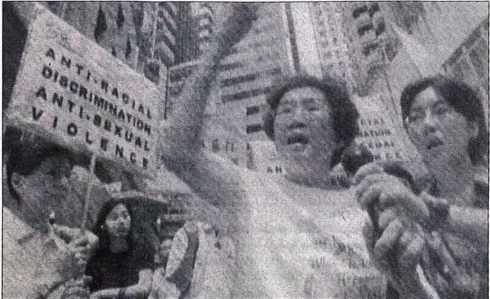

“Sekarang, kejadian itu tertuju kepada warga keturunan Tionghoa. Jika tidak diberantas, hal itu akan menimpa suku bangsa lainnya juga,” demikian antara lain bunyi pernyataan bersama tersebut.

Selain ramai-ramai membuat pernyataan keprihatinan, di berbagai tempat diadakan pula doa bersama. Misalnya, doa yang dinaikkan oleh Masyarakat Korban dan Gerakan Orde Hati Nurani Pembela Korban di Lapangan Banteng, Jakarta Pusat, pada awal Agustus kemarin.

Doa massal dari berbagai umat beragama—Islam, Kristen, Katolik, Buddha, Hindu, Kong Hu Chu, dan Aliran Kepercayaan—ini pada intinya mengutuk para pelaku tindak kerusuhan dan pemerkosaan yang biadab. Mereka juga memohon, agar para korban dan keluarga mereka diberi kekuatan iman serta ketabahan atas kejadian memilukan yang telah menimpa mereka.

Doa bersama pun dihaturkan para aktivis perempuan dari berbagai organisasi. Meski hujan lebat sempat mengguyur Jakarta 23 Juli silam, acara Doa Perempuan di Gedung Wanita Nyi Ageng Serang, kawasan Kuningan, Jakarta, tetap berlangsung hikmat.

Tak kurang 1.000 peserta berikrar, melawan semua kebijakan dan politik kekerasan oleh siapa pun. Kekerasan adalah cara yang tidak dapat dimaafkan, karena tidak hanya mengancam keselamatan, tetapi juga menjadi penghalang utama bagi tegaknya keadilan, perdamaian, dan demokrasi di Indonesia.

Acara senada diadakan pula di Gelanggang Olah Raga Saparua, Bandung, pada Sabtu (8/8). Doa bersama dan renungan suci ini bertujuan meningkatkan kepekaan dan kesadaran masyarakat, termasuk penguasa negara, tentang perlunya melakukan usaha-usaha serius mencegah, menghapus, dan menanggulangi tindak kekerasan terhadap perempuan di Indonesia.

Tidak hanya di lingkup nasional rasa keprihatinan membahana. Masyarakat luar negeri yang sangat sensitif terhadap isu hak asasi manusia, turut terkesima atas perbuatan keji di alam merdeka ini. Mereka lantas menggemakan suara.

Seperti yang dilakukan Huaren (baca: hua-den)—sebuah lembaga swadaya masyarakat yang menjembatani orang-orang Tionghoa perantauan di seluruh dunia. Sebagai ungkapan simpati sekaligus menuntut persamaan hak asasi bagi kaum Tionghoa Indonesia, Huaren melancarkan kampanye pita kuning (Yellow Ribbon Campaign).

Entah apa maksud sebenarnya dari pemilihan warna kuning sebagai tanda simpati bagi etnik Tionghoa ini. Yang jelas, pasti bukan berarti Golkar. Warna kuning dalam masyarakat Tionghoa menjadi simbol keagungan. Raja-Raja Tiongkok zaman dahulu memilih warna ini sebagai warna baju kebesarannya. Kuning juga mengingatkan pada sungai yang mengaliri daratan Republik Rakyat Cina, Yang Tze.

Selain kampanye pita kuning, Huaren aktif mengkampanyekan masalah yang tengah dihadapi etnik Tionghoa Indonesia ini di forum-forum internasional, terutama Amerika Serikat, tempat di mana organisasi non-profit ini berpusat.

Aksi protes juga dilakukan di berbagai Konsulat Jenderal Republik Indonesia (Konjen-RI) di mancanegara. Antara lain di Hong Kong, Taipeh (Taiwan), dan sejumlah negara bagian di Amerika Serikat.

## HONG KONG

RIBUAN WARGANYA MEMADATI PUSAT KEBUDAYAAN di Distrik Tsim Sha Tsui, akhir Juli kemarin. Mereka menggelar doa bersama bagi para korban pemerkosaan massal di Jakarta.

Penyalaan lilin simpati dan doa juga diselenggarakan di Victoria Park. Acara yang dimotori Partai Demokratik Hongkong (PDH) ini ditindaklanjuti dengan rentetan unjuk rasa di depan Konsulat Jenderal Republik Indonesia (Konjen-RI) di sana.

Aksi protes itu mulai marak selang beberapa hari setelah kerusuhan. Mereka mendesak agar pemerintah RI melindungi warga etnik Tionghoa. “Kami sekerasnya menuntut pemerintah Indonesia untuk menghargai hak asasi,” demikian bunyi sebuah spanduk yang digelar para pengunjuk rasa.

“Warga Tionghoa Indonesia masih dilanda kecemasan akan kemungkinan terjadinya aksi kerusuhan kembali. Bukan hanya soal bekerja, hidup pun mereka tak tenang,” tandas mereka penuh semangat.

## TAIPEI

SEBAGAI PROTES ATAS PERKOSAAN MASSAL terhadap perempuan etnik Tionghoa Indonesia selama kerusuhan bulan Mei di Jakarta, pada 3 Agustus 1998 ratusan warga Taiwan melemparkan telur ke Konjen-RI di Taipei.

Mereka membawa berbagai spanduk, dan melemparkan uang kertas ke udara sebagai tanda duka cita. Para pengunjuk rasa meminta pula, agar Indonesia menghukum para pemerkosa, dan memberi kompensasi kepada korban.

Aksi protes yang diorganisir oleh Partai Baru dan Asosiasi Warga Tionghoa Perantauan Yang Pulang Kampung di Indonesia, meminta pemerintah Indonesia mengubah konstitusinya, untuk menjamin perlakuan yang sama kepada pribumi dan imigran. “Hanya dengan cara itu, delapan juta etnik Tionghoa bisa hidup tanpa rasa takut diperlakukan secara diskriminatif,” ujar mereka.

Bukan di Taipei saja warga Taiwan protes, tapi mereka juga datang ke Jakarta—diwakili delegasi Taipeh Women’s Rescue Foundation. Mereka menemui Komnas HAM pada awal Agustus lalu.

Para anggota misi tersebut meminta pemerintah Indonesia mengambil tindakan serius.’ “Penganiayaan dan pemerkosaan terhadap perempuan etnik Tionghoa tidak dapat ditolerir dan harus dikutuk,” ujar Profesor Wong Muo, pemimpin delegasi. “Perlindungan yang sangat mereka butuhkan telah diabaikan,” tambahnya.

## AMERIKA SERIKAT

SIMPATI MENGALIR PULA DARI DARI NEGARA yang mengagungkan demokrasi dan hak asasi manusia. Pada 31 Juli lalu, anggota Kongres Amerika menerima Romo Sandyawan, Karlina Leksono, dan beberapa anggota lain, untuk memberikan kesaksian di depan anggota Kongres.

Rombongan aktivis HAM dari Indonesia ini membawa misi kemanusiaan, untuk membela para korban kerusuhan Mei, dan rakyat kecil Indonesia umumnya. Mereka berharap, kasus pemerkosaan massal, pembakaran, dan penjarahan yang terjadi Mei silam tidak terulang lagi.

Mereka menekankan, amuk massa itu sebenarnya bukan disebabkan faktor agama, etnik, atau primordial lain. Temuan-temuan Tim Relawan memperlihatkan, adanya kelompok terorganisir di belakang kerusuhan tersebut.

“Saya pikir, kehadiran kawan-kawan ini cukup positif. Jangan diartikan kalau mereka berbicara terus terang dan apa adanya, itu tidak nasionalis,” kata Christianto Wibisono, yang kebetulan juga berada di Negeri Paman Sam sebagai pembicara sebuah seminar.

Di negeri ini aksi protes terus marak. Pada awal Agustus ini di Konjen-RI di Washington D.C., Chicago, Los Angeles, San Francisco, dan beberapa kota lain.

Mereka berharap, pemerintah Indonesia meniadakan diskriminasi rasial, melindungi hak asasi manusia, dan kebebasan beragama. Selain itu, memberikan bantuan dan kompensasi kepada para korban serta keluarganya, juga meminta maaf kepada etnik Tionghoa Indonesia, karena tidak adanya perlindungan yang cukup.

KETIKA ARTIKEL INI DITULIS (6/S), TERSIAR KABAR dari Konferensi Hak Asasi Manusia Sedunia yang tengah berlangsung di Jenewa, Swiss, bahwa Mary Robinson, Ketua Komisi Hak Asasi Manusia Perserikatan Bangsa-Bangsa, secara jelas mengatakan sangat prihatin dengan amuk massa dan pemerkosaan yang terjadi di Jakarta pertengahan Mei lalu.

Semasa rezim Orde Baru berkuasa, Komisi HAM PBB mengaku menemui kesulitan menjangkau wilayah Indonesia. Mary berharap, setidaknya tahun depan, Komisi HAM PBB dapat membuka kantor perwakilan di Jakarta, untuk memantau pelaksanaan hak asasi manusia di seluruh Nusantara.

Jika perhatian dunia internasional begitu menggebu-gebu terhadap Indonesia, mengapa kita sendiri yang menjadi bagian dari negara ini, tidak mulai berkaca, sudahkah kita menjunjung hak asasi itu?

<em>dari berbagai sumber</em>

---

# Kekerasan dan Teror Masih Berlangsung

<strong>Ikut-Ikutan atau Karena Para Pelaku Masih Berkeliaran?</strong>

TIGA BULAN BERLALU SEJAK AMUK MASSA mencoreng wajah Ibu Kota. Kehidupan “seolah” telah berjalan normal. Namun, di tengah kesibukan rutinitas sehari-hari, di lubuk kebanyakan warga masih terselip rasa was-was.

Betapa tidak. Di sana-sini teror tetap leluasa bertebaran, dan tindak kriminal bahkan pemerkosaan masih terjadi. Romo Sandyawan, Sekretaris I Tim Relawan untuk Kemanusiaan, mencatat, tanggal 20 Juni dan 2 Juli masih terjadi pemerkosaan terhadap dua perempuan etnik Tionghoa, dengan modus operandi yang sama seperti pemerkosaan massal Mei lalu.

Sebuah sumber lain mengisahkan, dua karyawati di bilangan Sudirman, Jakarta, dibawa lari sopir taksi, saat mereka makan siang. Lisa (bukan nama sebenarnya) menuturkan pula pengalamannya, ketika pulang kerja sore hari naik taksi dari kawasan Jakarta Utara.

Dari bagasi kendaraan umum itu, tiba-tiba muncul seorang pria dengan belati di tangan. Lisa dan adik perempuannya dipaksa mengambil sejumlah uang tabungan mereka lewat mesin ATM. Syukurlah, Lisa dan adiknya luput dari keganasan kedua pelaku berkat kuasa Tuhan.

Ikut-ikutan karena merasa ketika kerusuhan Mei lalu belum dapat bagian, ataukah lantaran para pelaku penjarahan dan pemerkosaan masih bebas berkeliaran di antara masyarakat?

Hari baru pukul 19 malam. Sebuah bus kota dikuasai segerombolan pelajar. Mereka habis tawuran. Tapi, dengan enaknya mereka melucuti harta semua penumpang etnik Tionghoa, dan tanpa segan—padahal mereka anak sekolahan—mereka melakukan perundungan seksual terhadap perempuan dalam bus itu.

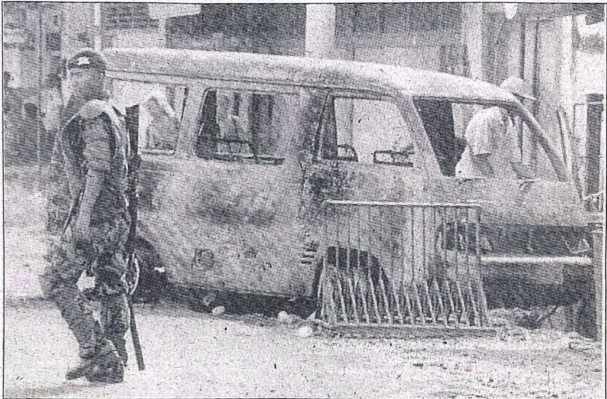

## Teror Untuk Masyarakat Luas

“Kalau begitu caranya, saya aja yang orang asli sini juga takut,” cetus seorang perempuan menanggapi kisah-kisah ngeri bak dalam cerita kriminal rekaan di atas.

Tak heran jika para orang tua membekali wejangan kepada para anak gadisnya, terutama, agar jangan keluar malam hari, hindari jalan-jalan sepi dan gelap serta kendaraan umum dengan segelintir penumpang.

Bukan hanya warga Jakarta yang dicekam ketakutan. Warga kota Bandung, Medan, Palembang, Solo, dan Surabaya, yang pernah disulut kerusuhan sejenis juga ketar-ketir.

Bahkan, beberapa sumber yang dihubungi di daerah-daerah tanpa kerusuhan pun, mengaku was-was. Mereka cemas, jangan sampai peristiwa tragis seperti itu terjadi di daerahnya.

“Dengan amuk massa tersebut, hendak diciptakan teror terhadap masyarakat luas. Untuk membuat teror, kan, harus ada korban. Dan yang dikorbankan adalah etnik Tionghoa, terutama kaum perempuannya,” Ita Nadia, Koordinator Tim Relawan untuk Kemanusiaan Divisi Kekerasan terhadap Perempuan, menyimpulkan.

## Foto-foto dan Kaset Video

SELAIN TEROR BERUPA PENCULIKAN, PEMERKOSAAN, dan pengambilan harta benda secara paksa; bentuk teror lain berupa beredarnya foto-foto dan kaset video yang konon berisi peristiwa pemerkosaan massal.

Seorang sumber, mengaku dibisiki pedagang di sebuah pusat perdagangan. Katanya, ada barang bagus. Ia lalu diajak ke sebuah tempat, dan diputarkan film cuplikan-cuplikan adegan pemerkosaan. Si pedagang menawari kaset rekaman itu seharga Rp 175.000,-

Sementara itu, di Internet beredar foto-foto—yang katanya—hasil jepretan saat pemerkosaan massal 13-14 Mei lalu. Betulkah?

“Kami masih melakukan verifikasi mengenai kebenarannya,” ujar Ita. Tapi, Romo Sandyawan cepat tanggap. Begitu tercium gejala teror berupa penyebaran foto-foto dan kaset video itu, sekitar akhir Juni lalu, ia sudah memberi peringatan.

Menurutnya, penyebaran foto-foto itu juga merupakan bagian dari teror. Padahal, foto-foto tersebut sebenarnya menggambarkan penyiksaan yang dialami perempuan aktivis di Timor Timur. Lama sebelum terjadi amuk massa dan pemerkosaan massal Mei silam, foto-foto itu sudah terpampang di beberapa situs di Internet yang mengulas Timor Timur.

## Amplop Berisi Uang

TEROR BENTUK LAIN BERUPA, DIBAGI-BAGIKANNYA amplop berisi uang kepada sejumlah warga Indonesia. Seorang pria keturunan Tionghoa yang berkulit gelap, ketika melintas di Bandung Indah Permai turut kecipratan amplop demikian.

Ketika dibuka, isinya sejumlah uang disertai selebaran ajakan untuk memerkosa perempuan etnik Tionghoa pada tanggal yang telah ditentukan. Teror itu menyebar, menimbulkan aura ketakutan.

Syukurlah, pada hari yang ditentukan tidak terjadi apa-apa. Namun, semua warga jadi rugi. Sekolah-sekolah hanya dipenuhi murid-murid pria. Yang wanita tak berani keluar rumah. Begitu pula tempat-tempat kerja.

Teror amplop uang juga terjadi di Ibu Kota. Saat melintasi kawasan Kota, seorang warga keturunan Tionghoa menjumpai kerumunan orang. Merasa penasaran, ia ikut nimbrung.

Ternyata, yang dikerumuni adalah seorang pria. Ia membawa tiga koper berisi uang. Kepada setiap orang yang mendengar celotehannya, diberi Rp 100.000,-. Tapi, tentu saja diiringi pesan, untuk: membunuh orang Tionghoa yang dijumpai pada tanggal tertentu.

Perintah yang sungguh tidak berperikemanusiaan. Lebih lagi, katanya, kalau sudah berhasil membunuh dan memberi buktinya, si pelaku akan diberi imbalan tambahan Rp 1 juta.

Kisah teror amplop berisi uang dengan perintah memerkosa atau membunuh dengan cepat beredar dari mulut ke mulut. Kebenarannya memang sangat patut dipertanyakan. Namun, kengerian yang ditimbulkan tampak jelas dari perilaku para warga.

Sampai kapan hal ini akan berlangsung? Dapatkah ketenangan hidup bersama itu diperoleh kembali?

Beban yang harus disandang warga masyarakat akibat krisis ekonomi sudah cukup berat. Mengapa harus disertai teror-teror seperti itu? Di manakah penghargaan terhadap hak asasi manusia?

Kiranya sudah saatnya para perekayasa teror menghentikan aktivitasnya. Atau, memang bangsa ini tengah sengaja diarahkan ke ambang kehancuran?

<em>dari berbagai sumber</em>

---

# Bongkar dan Adili Segera!

KEDAMAIAN HIDUP BERSAMA MENDADAK TERUSIK, begitu terjadi kerusuhan yang dibarengi perkosaan etnik Tionghoa, pada pertengahan Mei lalu. Dalam waktu amat singkat, bangsa ini bertatap muka dengan kematian rasa berbangsa, kebinasaan rasa persaudaraan, penumpulan hati nurani, kelumpuhan rasa aman bertetangga, dan kehabisan kepercayaan terhadap aparat keamanan yang seyogianya melindungi seluruh rakyat tanpa kecuali.

Meski sudah tiga bulan berlalu, hingga laporan ini ditulis, masih belum tampak titik terang penyelesaian masalah yang menyangkut hak asasi perempuan ini.

Malah, ada yang cenderung mempertanyakan kebenaran terjadinya pemerkosaan, lantaran belum satu pun laporan diterima aparat keamanan. Sementara, teror mengalir deras, dan pemerkosaan dengan modus operandi yang sama masih berlangsung sampai kini (awal Agustus 1998).

Mempeti-eskan dan melupakan begitu saja kejadian tragis ini, sama artinya dengan mengabsahkan tindakan brutal tak berperikemanusiaan itu. Sama juga maknanya dengan membenarkan apa yang tidak baik sebagai yang baik. Kalau sudah demikian, jangan salahkan bila ada orang yang sudah tidak dapat lagi membedakan antara yang biadab dan beradab.

Dan jika pelecehan serta pemerkosaan sudah menjadi hal yang biasa di masyarakat, celana dalam antipemerkosaan yang kini ramai diperdagangkan pun, bukan solusi pemecahan masalah asasi ini.

Tiba waktunya sekarang kita memperbaiki kerusakan total hidup bersama, yang diakibatkan oleh kerusuhan dan pemerkosaan Mei silam. Maka, 2 hal paling penting dilakukan—di samping memulihkan kondisi mental dan fisik para korban—adalah MEMBONGKAR DAN MENGADILI SEGERA, jaringan perencana dan pelakunya!

---

# Pertanggungjawaban Hati Nurani

SETELAH BERTEMU DENGAN SEBAGIAN DARI korban dan keluarga korban, dan setelah mencermati siaran media massa, serta laporan-laporan yang disusun oleh berbagai LSM, kami kaum pemuka agama dan masyarakat, sampai pada kesimpulan, bahwa kami perlu menyatakan secara tegas mengenai pokok yang amat memprihatinkan ini, yaitu bahwa

## 1. Dimanfaatkannya Perbedaan Suku dan Sosial Ekonomi di dalam Masyarakat sebagai Sarana untuk Memecah Belah

Memang di dalam sejarah bangsa Indonesia, kuno maupun modern, telah sering terjadi konflik rasial. Peristiwa yang terjadi pada tanggal 13-14 Mei 1998 yang lalu, sekali lagi merupakan konflik yang sangat keji dan biadab. Peristiwa tersebut jelas sekali merupakan pelanggaran hak-hak asasi manusia.

Masyarakat keturunan Tionghoa dihadapkan dengan masyarakat yang lain, dan selanjutnya mereka diadu domba. Di satu pihak, dengan alasan bahwa mereka adalah Tionghoa, maka harta benda mereka dijarah, tempat usaha mereka dirusak, tubuh mereka dianiaya, nyawa mereka dihilangkan, dan seakan-akan ingin lebih memuaskan diri lagi—kaum perempuan dari kalangan mereka dilecehkan, bahkan diperkosa. Karena rasa malu dan putus asa, beberapa orang dari korban mengakhiri hidupnya sendiri.

Di pihak lain, rakyat jelata yang sebagian hidup dalam kemiskinan, kehilangan pekerjaan, dan terpinggirkan dari pusat-pusat pengambilan keputusan, dipancing sedemikian sehingga sampai ribuan mati terpanggang. Yang lebih mengerikan adalah bahwa semua itu dilakukan dengan cara-cara yang terorganisir dan sistematis.

## 2. Penganiayaan yang Didasarkan pada Kenyataan yang Ada di Luar Pilihan Seseorang

Dilahirkan sebagai anggota dari salah satu suku bangsa bukanlah pilihan orang yang bersangkutan. Itu adalah anugerah yang berasal dari Tuhan sendiri kepada makhluk-Nya. Dengan demikian, setiap orang memiliki kekhasannya masing-masing.

Perbedaan yang muncul karena kekhasan itu adalah suci dan dimaksudkan agar manusia saling bekerja sama, saling melengkapi, dan saling memperkaya diri, bukan untuk dipertentangkan satu sama lain, sehingga menjadi permusuhan.

Demikian juga menjadi orang Tionghoa. Di satu pihak, perlakuan buruk atas dasar perbedaan ras, khususnya pengniayaan yang tertuju kepada mereka akhir-akhir ini, adalah tindakan yang merendahkan martabat manusia dan melawan keadilan.

Kekerasan yang dilakukan terhadap mereka yang dilahirkan dan dibesarkan di Indonesia, sebagai satu-satunya negeri dan tanah air mereka, telah menodai bangsa Indonesia sendiri.

Di lain pihak, kemiskinan rakyat bukanlah kesempatan untuk menjerumuskan mereka ke dalam sikap dan tindakan yang kejam, biadab, dan tak berperikemanusiaan, melainkan merupakan panggilan untuk mengajak mereka memperkuat diri agar dapat menciptakan hidup yang berkualitas.

## 3. Perbedaan Dipertentangkan

Hidup di dalam sebuah masyarakat yang majemuk seperti Indonesia, harus mengakui adanya kenyataan, bahwa di sini terdapat berbagai kelompok yang memiliki perbedaan-perbedaan.

Hal ini tidak hanya penting untuk menjaga keutuhan bangsa, tetapi juga penting bagi harga diri kita sebagai manusia. Apalagi jika ingin disebut sebagai manusia beragama, karena keanekaragaman itu dari Tuhan sendirilah asalnya.

Kami tidak setuju, bahwa perbedaan yang ada dijadikan sumber pertentangan yang membuat kelompok yang satu berhadapan dengan kelompok yang lain sebagai lawan.

## 4. Tiadanya Perlindungan Hukum

Di dalam sebuah negara hukum, harus ada jaminan keamanan yang nyata, terutama keamanan fisik, yang diwujudkan di dalam bentuk perundang-undangan yang diberlakukan dengan sanksi lewat sistem peradilan, serta wajib dilaksanakan oleh segenap aparat keamanan, Tanpa hal ini, kehidupan sosial, ekonomi, dan budaya akan mengalami kemerosotan.

OLEH SEBAB ITU, KAMI INGIN MENGUNGKAPKAN rasa simpati kami sedalam-dalamnya kepada mereka yang menjadi korban kekerasan yang terjadi sekitar dua hari itu, kepada ribuan orang yang kehilangan nyawa, juga kepada saudara-saudara warga keturunan Tionghoa yang dijadikan sasaran kebencian. Semoga keluarga serta handai taulan yang ditinggalkan mendapat kekuatan lahir-batin untuk menanggung derita yang menimpa.

Selain itu, kami menyerukan kepada Pemerintah dan pihak-pihak yang berwajib, serta siapa saja yang tergerak untuk memperjuangkan keadilan, agar segera mengakhiri dengan sekuat tenaga dan berusaha agar tidak terjadi lagi, segala macam bentuk pemecahbelahan kehidupan bermasyarakat, dengan mempertentangkan perbedaan-perbedaan yang ada.

Sekarang kejadian itu tertuju pada warga keturunan Tionghoa; jika tidak diberantas, hal itu akan menimpa suku bangsa lain juga. Maka hendaknya diusut secara transparan dan tuntas peristiwa yang sesungguhnya, mengadili dan menghukum mereka yang berada di dalam jaringan yang menyulut dan mengobarkan kebencian itu, hingga terjadinya dan berkembangnya peristiwa biadab pada tanggal 13-14 Mei 1998 tersebut.

Akhirnya kami mengajak semua orang yang ingin dan mau menjunjung tinggi nilai kemanusiaan, untuk berusaha dan bekerja sama melawan segala sesuatu yang memungkinkan tumbuhnya pengadudombaan di negeri ini. Sehingga, di tanah air Indonesia ini dapat terbangun dan tercipta sebuah bangsa beradab yang menghargai harkat dan martabat manusia.

<b>Jakarta, 17 Juni 1998 Masyarakat Dialog Antar Agama</b>

